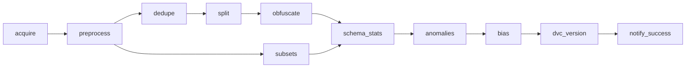
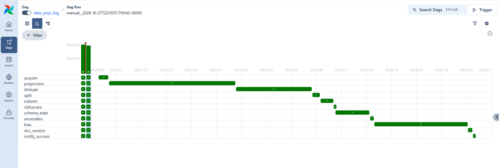
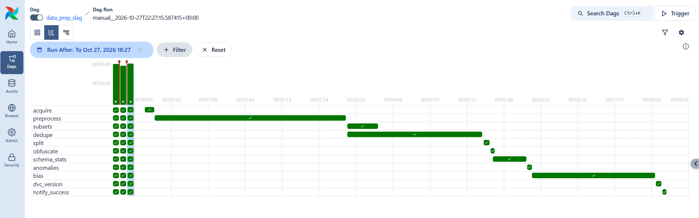

# Distillate: Data Pipeline

> **Content warning:** the datasets contain slurs, threats, and hateful language.

`data_prep_dag` takes the project from nothing to training-ready data: download (Kaggle), clean, deduplicate, split, schema and statistics (TFDV), anomaly checks with alerts, bias analysis with mitigation, and versioning with DVC. Shared file formats and interfaces are in [CONTRACTS.md](CONTRACTS.md).

## 1. Environment setup

**Prerequisites**

| | |
|---|---|
| Docker Desktop | **8 GB memory or more** (Settings → Resources). On Apple Silicon also turn on Settings → General → *Use Rosetta for x86/amd64 emulation* — the image is `linux/amd64` because TFDV publishes no Linux arm64 wheel |
| Git | any recent version |
| Python 3.12 | only to run the tests outside Docker |
| Disk | about 15 GB: competition downloads, raw and processed Parquet, and the DVC cache |

**Get the code.** Every command in this README runs from `Data-Pipeline/`, not the repo root:

```bash
git clone https://github.com/Nishaant-Soni/Distillate.git
cd Distillate/Data-Pipeline
```

**Accept both Kaggle competitions' rules.** Do this first, in a browser, on the
account whose credentials you are about to use. Downloads return 403 until you do,
and the rules are accepted per competition:

- <https://www.kaggle.com/c/jigsaw-toxic-comment-classification-challenge/rules>
- <https://www.kaggle.com/c/jigsaw-unintended-bias-in-toxicity-classification/rules>

**Credentials.** Compose reads `.env` from this folder only, so the copy lives in
`Data-Pipeline/`, not the repo root:

```bash
cp .env.example .env
```

Fill in the Kaggle block from <https://www.kaggle.com/settings/api>. Either route works:

- **`KAGGLE_API_TOKEN`** — the access token that page shows. Checked first, so this is the simplest.
- **`KAGGLE_USERNAME` + `KAGGLE_KEY`** — from *Legacy API Credentials → Create Legacy API Key*,
  which downloads `kaggle.json` holding both values. If you use these, leave
  `KAGGLE_API_TOKEN` empty, because a value there takes precedence.

Everything else in `.env` has a working default. With no `SLACK_WEBHOOK_URL` alerts are
logged instead of posted, and `DVC_PUSH=false` keeps a fresh clone green without any GCP
credentials. `.env` is git-ignored; never commit it.

**If a variable is already set in your shell, Compose uses that and ignores `.env`.**
A stale `KAGGLE_API_TOKEN` left in your environment will produce 401s that look like bad
credentials. Check with `echo $KAGGLE_API_TOKEN` (`echo %KAGGLE_API_TOKEN%` on Windows)
and unset it if it is not the one you want.

**On Windows**, Compose does not set `HOME`, so set `GCLOUD_CONFIG_DIR` in `.env` to the
full path of your gcloud folder (`C:\Users\<you>\.config\gcloud`) rather than relying
on a variable. Leave it empty if you are not pushing to GCS.

## 2. Running the pipeline

Five commands from a fresh clone:

```bash
cd Distillate/Data-Pipeline          # skip if you are already here from section 1
cp .env.example .env                 # 1. then add your Kaggle credentials (section 1)
docker compose build                 # 2. 20-40 min first time; TensorFlow is large
docker compose up -d                 # 3. Airflow UI on http://localhost:8080
docker compose exec airflow-scheduler airflow dags trigger data_prep_dag   # 4.
cat reports/run_summary.json         # 5. what the run did
```

The UI login comes from `_AIRFLOW_WWW_USER_*` in `.env`. The build prints
`TFDV checkpoint OK` when the TensorFlow environment is healthy; if that line is missing
the build has failed, and nothing after it will work.

**Before step 4**, wait until `docker compose ps` shows the Airflow services as `healthy`
(about a minute). Triggering earlier can fail with "DAG not found", because the DAG
processor has not read the DAG yet.

**Following the run.** The Grid view in the UI shows each task live. From the terminal:

```bash
docker compose exec airflow-scheduler airflow dags list-runs data_prep_dag   # queued, running, success, failed
```

**Optional settings.** Set these in `.env` before step 3:

| Variable | Effect | Details |
|---|---|---|
| `SLACK_WEBHOOK_URL` | posts alerts to Slack instead of only logging them | section 9 |
| `DVC_PUSH=true` | `dvc_version` also pushes the data to the GCS remote | section 7 |
| `PIPELINE_MODE=baseline` | runs the 11 tasks as one sequential chain | section 8 |

Containers read `.env` only when they are created, so after changing it run
`docker compose up -d` again before triggering.

**Stopping.** `docker compose down` stops everything and keeps the Kaggle download volume,
so the next run skips the downloads. Avoid `docker compose down -v` unless you want a cold
run: it deletes that volume and the Airflow database with it.

A full run on real data takes roughly five minutes of task time after the downloads are
cached. **Keep the machine awake** — everything runs in Docker on your laptop, so sleep
suspends the run and tasks can exceed their timeouts on wake.

**Where the outputs go**

| Path | Contents |
|---|---|
| `data/kaggle/` | competition downloads (a Docker volume, so reruns skip them) |
| `data/raw/` | raw Parquet plus `manifest.json` with row counts and checksums |
| `data/cache/` | the 1.8M-row Civil train file: untracked, not in DVC |
| `data/processed/` | the contract files in [CONTRACTS.md](CONTRACTS.md) section 2 |
| `data/splits/` | id lists per split, and the drift manifest |
| `reports/summaries/<task>.json` | one summary per task: rows in, rows out, drops, duration |
| `reports/run_summary.json` | all of them merged, written by `notify_success` |
| `reports/dedupe/removed_ids.csv` | every row dedupe removed, with the reason and the matching id (ids only, never text) |
| `reports/schema/validation.json` | the TFDV validation result for every raw and processed file |
| `reports/bias/` | `bias_report.md` and `bias_metrics.json` from the bias stage |
| `logs/` | Airflow task logs |

**Rerunning one task.** In the UI, select the task and press *Clear*; it reruns with
everything downstream. To run a single stage outside Airflow, use the CLI from
[CONTRACTS.md](CONTRACTS.md) section 3:

```bash
docker compose exec --workdir /opt/airflow/repo/Data-Pipeline airflow-scheduler \
  python -m scripts.stage --stage dedupe --config config/pipeline.yaml
```

Stages are safe to rerun: every write goes through `utils.atomic_write`, so an
interrupted task leaves the previous output intact rather than a half-written file.

**Common first-run problems**

| Symptom | Cause and fix |
|---|---|
| `no configuration file provided: not found` | You are in the repository root. The compose file lives in `Data-Pipeline/`; `cd` there first |
| `acquire` fails with a 401 | Either the Kaggle credentials are wrong, or a variable set in your shell is overriding `.env` — see section 1 |
| `acquire` fails with a 403 | You have not accepted that competition's rules yet. They are accepted per competition, so check both |
| `Permission denied: .../\.config/kaggle` | An older image. Rebuild, or set `KAGGLE_CONFIG_DIR=/tmp/kaggle` in `.env` |
| The build never prints `TFDV checkpoint OK` | The TensorFlow environment failed to build; nothing downstream will work. Rebuild with `docker compose build --no-cache` |
| `dvc push` warns about credentials | Expected unless you ran `gcloud auth application-default login` and set `GCLOUD_CONFIG_DIR`. The run still succeeds; only the upload is skipped |

### Logging and tracking

- **One logger.** Every module logs through `utils.get_logger(__name__)`, in one format:
  `time level [module] message`. INFO and WARNING go to stdout and ERROR to stderr, so a
  warning doesn't show up as an error in the Airflow UI. The level comes from
  `DISTILLATE_LOG_LEVEL` (default `INFO`).
- **Where logs go.** Each task's log is in the Airflow UI (select the task, then *Logs*) and
  on disk under `logs/`, which is Airflow's log folder.
- **Per-task tracking.** Every stage writes its own `reports/summaries/<task>.json`: rows in,
  rows out, dropped rows with the reason for each, duration, and whether it ran as the real
  stage or a stub. Tasks never write to a shared file, so parallel tasks can't overwrite each
  other.
- **Per-run tracking.** `notify_success` merges those summaries into
  `reports/run_summary.json`, with the totals, which stages were real, and whether the Slack
  message was delivered. Alerts for failures and anomalies are covered in section 9.

### Running tests locally (no Docker needed)
```bash
cd Distillate/Data-Pipeline
python3.12 -m venv .venv
source .venv/bin/activate            # Windows: .venv\Scripts\activate
pip install -r requirements-dev.txt
pytest
ruff check .
```

**CI.** `.github/workflows/data-pipeline-ci.yml` runs on every pull request, and every push
to `main`, that touches `Data-Pipeline/` or the workflows:

- `lint-test`: `ruff check .`, then `pytest`. It installs `requirements.txt` against the same
  Airflow constraints file as the image, so the DAG tests run here too.
- `tf-tests` (optional): `tests/test_schema_stats.py` in a Python 3.11 environment built from
  `requirements-tf.txt`, since TFDV has no Python 3.12 wheel.

**What the tests cover.** About 200 unit tests: one file per stage, plus the shared helpers
and the DAG. They use small
made-up data and never touch the network. The DAG tests skip where Airflow isn't installed,
and the schema tests skip outside the TFDV environment.

| Test file | What it checks |
|---|---|
| `test_acquire.py` | Kaggle columns renamed; unscored test rows dropped; comments that are literally "NA" or "null" kept as text; corrupted zips deleted; existing files not downloaded again; wrong row counts rejected; the full Civil train file goes to the cache |
| `test_preprocess.py` | NFKC, HTML and whitespace cleanup; empty text dropped; Wikipedia labels must be 0/1; the Civil 0.5 boundary (0.5 is positive, 0.4999 is not); both date formats parse; whole-word lexicon matching; the drop-rate rule (fail above 0.1%, warn below) |
| `test_dedupe.py` | Exact and near duplicates removed; gate rows never removed; distinct comments kept; label conflicts counted; the same result every run |
| `test_split.py` | Same seed, same split; row order doesn't matter; sets are disjoint; validation within 1 point of 15%; exact canary size; every label in every set; gate unchanged |
| `test_subsets.py` | Configured sizes; no overlap; drift sorted by date and drawn from the whole period; stratification keeps the toxic rate; teacher shift-check ids never reach the canary or drift; a missing exclusion list stops the stage |
| `test_obfuscate.py` | Configured size; `_obf` ids; text changes but labels don't; deterministic; all three tricks used; derived columns recomputed |
| `test_schema_stats.py` | Schema inference; clean files pass; a label out of range, missing text, a missing or unexpected column, a missing file and a missing schema are each caught |
| `test_anomalies.py` | Clean data passes every check, and each check fires on crafted bad input: row counts, id overlap, missing text or labels, label domain, duplicate ids, long text, prevalence gap, dates, subset sizes; every check runs even after one fails |
| `test_bias.py` | Word-boundary lexicon matching; per-group metrics against a hand computation; small slices not judged; reweighting touches only non-toxic identity rows; factor selection; an end-to-end run |
| `test_dag.py` | The DAG imports; tasks and dependencies match `pipeline_graph.py`; every task has a timeout and a failure alert; `acquire` retries twice; the DAG is manual-only and never backfills |
| `test_stage.py` | The real module is used once merged, otherwise the stub; a broken import isn't hidden; stubs match the contract and never overwrite real output |
| `test_utils.py`, `test_alerts.py`, `test_run_summary.py`, `test_dvc_version.py` | Logging split and level; config loading; atomic writes; alerts with and without a webhook, a broken webhook never raising; the run summary; `dvc add` and `dvc push` behaviour |

## 3. Code structure

```text
Data-Pipeline/
├── dags/data_prep_dag.py     the DAG: 11 tasks built from the graph below
├── config/
│   ├── pipeline.yaml         every tunable value; seed 42; no script hard-codes these
│   ├── identity_terms.txt    identity lexicon (owner: Ruchita; others only read it)
│   └── civil_teacher_shift_ids.txt  teacher shift-check ids kept out of canary_civil and drift
├── scripts/
│   ├── stage.py              one entry point per stage: real module if merged, stub if not
│   ├── pipeline_graph.py     the task graph as data, so it is testable without Airflow
│   ├── stubs.py              contract-shaped placeholder output for unmerged stages
│   ├── utils.py              get_logger, load_config, atomic_write, write_summary, timed
│   ├── alerts.py             send_alert plus the Airflow on_failure_callback
│   ├── columns.py            label names and the Kaggle-to-contract column renames
│   ├── errors.py             the pipeline's typed errors
│   ├── parquet_io.py         chunked Parquet writing and SHA-256 helpers
│   ├── acquire.py            download both competitions, reshape, write the manifest
│   ├── preprocess.py         label casting, NFKC and entity cleanup, derived columns
│   ├── dedupe.py             exact and MinHash-LSH near-duplicate removal
│   ├── split.py              seeded multilabel train/val split, canary carve-out, gate
│   ├── subsets.py            Civil H2, canary, bias set, 20 drift batches
│   ├── obfuscate.py          3,000 disguised toxic gate comments
│   ├── anomalies.py          every data check, each with a fail or warn severity
│   ├── schema_stats.py       TFDV statistics and schema validation (runs in /opt/tfenv)
│   ├── bias.py               slice metrics, reweighting, sample_weight into train.parquet
│   ├── dvc_version.py        dvc add, then dvc push when DVC_PUSH is true
│   └── run_summary.py        merges the task summaries and posts one Slack message
├── data/
│   ├── raw.dvc, processed.dvc  DVC pointers to the raw and processed Parquet
│   ├── schema/               the two curated TFDV schemas (section 5.4)
│   └── splits/               id lists per set and civil_drift_ids.csv
├── reports/                  run summary, dedupe removals, schema validation, bias report
├── tests/                    pytest; the Airflow DAG tests skip outside the image
├── Dockerfile                Airflow 3.3.2 on Python 3.12, plus TFDV on 3.11 at /opt/tfenv
└── docker-compose.yaml       LocalExecutor, Postgres, and the Kaggle download cache
```

**The DAG.** `data_prep_dag` in its default `optimized` shape. After `preprocess`, the
Wikipedia chain and the Civil chain are independent, so they run side by side and rejoin at
`schema_stats`:



With `PIPELINE_MODE=baseline`, the same 11 tasks run as one chain, in this order: `acquire`,
`preprocess`, `dedupe`, `split`, `subsets`, `obfuscate`, `schema_stats`, `anomalies`, `bias`,
`dvc_version`, `notify_success`. Section 8 compares the two shapes.

**Task settings and failure handling**

| Task | Runs in | Timeout (min) | Retries |
|---|---|---|---|
| `acquire` | main | 120 | 2, 2 min apart |
| `preprocess` | main | 60 | 1 |
| `dedupe` | main | 90 | 1 |
| `split` | main | 30 | 1 |
| `subsets` | main | 30 | 1 |
| `obfuscate` | main | 15 | 1 |
| `schema_stats` | `/opt/tfenv`, through a BashOperator | 60 | 1 |
| `anomalies` | main | 30 | 1 |
| `bias` | main | 60 | 1 |
| `dvc_version` | main | 60 | 1 |
| `notify_success` | main | 10 | 0 |

- **Timeouts.** Every task has an execution timeout, so a stage that hangs fails and sends an
  alert instead of running forever.
- **Retries.** `acquire` is the only task that uses the network, so it retries twice, two
  minutes apart. Other tasks retry once after one minute. `notify_success` doesn't retry,
  since it never fails the run.
- **Failure alerts.** Every task has the same `on_failure_callback`, set in the DAG's
  `default_args`, so a new task can't be added without it. It posts the DAG id, task id, error
  and log link (section 9).
- **Clear errors.** Stages raise typed errors that name the problem and the fix (section 4.6).
  A missing input file fails with its name and a pointer to run the upstream stage first.
  `anomalies` and `schema_stats` write their full report before failing, so the report on
  disk says what went wrong.
- **One run at a time.** The DAG is triggered by hand only (no schedule, `catchup=False`), with
  at most one active run, so two runs can never overwrite each other's outputs.

`tests/test_dag.py` checks these settings: the graph, the timeouts, the retries, the failure
callback, and the manual-only schedule.

**Two Python environments, one image.** Airflow and most stages run on Python 3.12.
`schema_stats` runs on Python 3.11 at `/opt/tfenv`, because TFDV 1.16.1 is the last release
built for this base image's glibc and it publishes no cp312 wheel. It also pins
`pandas<2`, which would drag the main environment backwards. The two never share memory:
Parquet on disk is the only thing that crosses between them.

**Adding a stage.** Add it to `TASKS` and the edges in `scripts/pipeline_graph.py`, and map
it to its module in `STAGE_MODULES` in `scripts/stage.py`. The DAG builds itself from that
graph, so no DAG edit is needed, and `tests/test_dag.py` checks the two agree.

## 4. Data acquisition and preprocessing
<!-- Owner: Praniti. Acquisition, cleaning choices, dedupe method and counts. -->
### 4.1 Data source: Kaggle instead of TFDS

The TFDS copies of both datasets now return HTTP 403, so the pipeline downloads the
original Kaggle competition files the TFDS versions were built from. Ids and row
counts are identical.

| Dataset | Kaggle competition | Files used |
|---|---|---|
| Wikipedia Toxicity | `jigsaw-toxic-comment-classification-challenge` | `train.csv`, `test.csv` + `test_labels.csv` |
| Civil Comments | `jigsaw-unintended-bias-in-toxicity-classification` | `train.csv`, `test_public_expanded.csv` (validation), `test_private_expanded.csv` (test) |

**One-time setup:** accept both competitions' rules on kaggle.com, create an API token
(Kaggle → Settings → API), and save it in `~/.kaggle/access_token` or the
`KAGGLE_API_TOKEN` environment variable. Never commit the token. The competition rules
allow non-commercial use and forbid redistribution, so raw data lives only in our
private DVC remote, never in Git.

### 4.2 Running these stages on their own

```bash
python -m scripts.stage --stage acquire
python -m scripts.stage --stage preprocess
python -m scripts.stage --stage dedupe
```

### 4.3 acquire: download and reshape

Writes six raw files to `data/raw/` and a `manifest.json` with row counts and SHA-256
checksums. A rerun verifies the files against the manifest and skips the download
(68 s first run, under 1 s afterwards).

| File | Rows |
|---|---|
| `wikipedia/train.parquet` | 159,571 |
| `wikipedia/test.parquet` (unscored `-1` rows removed) | 63,978 |
  | `civil/train.parquet` (in `data/cache/`, not DVC-tracked) | 1,804,874 |
| `civil/validation.parquet` | 97,320 |
| `civil/test.parquet` | 97,320 |
| `civil/identities_test.parquet` (test rows with `identity_annotator_count > 0`) | 21,577 |

The full Civil train split is too large to version, so its raw and clean files live in the untracked `data/cache/` folder. It can be rebuilt from the pinned Kaggle source; only the sampled subsets are versioned with DVC.

CSVs are read with `keep_default_na=False`. Without it, pandas turns comments that are
literally a "missing value" word into empty values: Civil train has 3 comments that
are exactly `None`, and they are kept as text.

### 4.4 preprocess: labels and light cleaning

| Step | Choice | Why |
|---|---|---|
| Wikipedia labels | must be 0/1, cast to `int8`; anything else stops the run | never guess a label |
| Civil labels | rater fraction kept as `<label>_frac`; `<label>` = fraction ≥ 0.5 | standard convention, fraction kept for later use |
| `sexual_explicit` | dropped | not one of our six labels |
| `created_date` | parsed to UTC with `format="mixed"` | 3 dates have no fractional seconds |
| Text | Unicode NFKC → HTML entities → whitespace collapsed | removes web noise; same order as the teacher lane |
| Not done | no lowercasing, punctuation removal or spelling fixes | CAPS, "!!!" and "1d10t" are toxicity signals |
| Derived columns | `char_len`, `has_identity_term`, `has_obfuscation` | used by validation, bias slicing and drift monitoring |

Result: 2,244,640 rows in, 2,244,640 out (no empty comments, no unparseable dates).
`has_obfuscation` (non-letter share above 0.3) flags 1.9% of Wikipedia train;
`has_identity_term` flags 6.9%.

### 4.5 dedupe: remove duplicates from Wikipedia train

Exact duplicates are found by comparing text after lowercasing and removing punctuation.
Near duplicates are found with MinHash LSH on word 3-grams, and every candidate is
confirmed with the real Jaccard similarity (≥ 0.9). Only train rows are removed; the
gate (test) set is never touched. Rows are processed in id order, so results are
identical on every run.

| Reason | Removed | Share toxic |
|---|---|---|
| Exact copy of a gate comment | 388 | 9.5% |
| Near copy of a gate comment | 1,486 | 1.6% |
| Exact duplicate within train | 664 | 14.9% |
| Near duplicate within train | 1,282 | 9.4% |
| **Total** | **3,820 of 159,571 (2.4%)** | |

- 1,874 train comments (1.2%) overlapped the gate set. Without removing them, test
  scores would be inflated.
- Most near overlaps with the gate set are Wikipedia template messages (welcome notes,
  deletion notices, spam warnings), which is why they are rarely toxic.
- 81 duplicate pairs had conflicting labels; the first by id is kept.
- The toxic rate stays about 9.6% after deduplication, so the label balance is unchanged.
- Every removal is listed in `reports/dedupe/removed_ids.csv` (ids only, never text).

### 4.6 Errors and alerts

| Problem | What happens |
|---|---|
| Download fails | `DataUnavailableError` with a hint about the rules and token; Airflow retries |
| Corrupted zip | the zip is deleted and `FileCorruptionError` raised, so the retry downloads it again |
| Wrong row count or changed file | `ManifestMismatchError` naming the file and both numbers |
| Missing or invalid label | `LabelError` with example ids |
  | More than 0.1% of a file dropped (`validation.max_missing_fraction`) | `DataQualityError`: the stage fails and the file is not written |
  | Fewer rows dropped, or unparseable dates | warning alert through `send_alert`; rows dropped (dates kept) |`send_alert` |
| Identity lexicon missing or empty | warning alert; `has_identity_term` is then False |

### 4.7 Tests

51 unit tests (`tests/test_acquire.py`, `tests/test_preprocess.py`, `tests/test_dedupe.py`)
use tiny made-up data and never touch the network. They cover the "None" comment trap,
label edge cases (0.5 vs 0.4999), missing labels, both date formats, HTML and Unicode
cleanup, empty and missing text, exact and near duplicates, gate protection, corrupted
zips, wrong row counts, and run-to-run determinism.

## 5. Splits, schema, and anomaly detection
<!-- Owner: Sai. -->

### 5.1 Wikipedia splits (`scripts/split.py`)

Deduplicated Wikipedia train is split with seeded multilabel iterative stratification (`iterative-stratification`, seed 42), so every label, including rare ones such as `threat`, has the same prevalence in train and validation. The canary set is then carved out of validation the same way, at an exact size. The Wikipedia test split becomes the gate set unchanged. Input rows are sorted by `id` first, so the split depends only on the data and the seed, not on row order.

| Set | Source | Size | Used for |
|---|---|---|---|
| `train` | Wikipedia train after dedupe | about 85% | Student training; carries `sample_weight` (1.0 until the bias step writes it) |
| `val` | Wikipedia train after dedupe | about 15%, minus the canary | Tuning, thresholds, early stopping |
| `canary_wikipedia` | Carved from `val` | exactly 2,000 (`splits.canary_wikipedia_size`) | Replayed against the live service as a health check |
| `gate` | Wikipedia test split, unchanged | 63,978 | CI evaluation gate; never used for training or tuning |

Outputs: `data/processed/wikipedia/{train,val,gate,canary_wikipedia}.parquet`, plus one id list per set in `data/splits/<set>_ids.txt`. Sizes and fractions come from `config/pipeline.yaml`.

Run on its own: `python -m scripts.split --config config/pipeline.yaml`. The summary in `reports/summaries/split.json` records row counts, each set's share of the deduplicated train, and per-label prevalence for every set.

### 5.2 Civil Comments subsets (`scripts/subsets.py`)

Civil Comments is the shifted-domain data: news-site comments, unlike the Wikipedia training data. Each subset comes from a different Civil split, so they share no comments, except that the Identities test split is an annotated subset of Civil test, so some `bias_eval` rows can also appear in `h2_eval`. That overlap is expected; the summary reports its size.

| Subset | Source | Size | Used for |
|---|---|---|---|
| `h2_eval` | Civil test, stratified on toxicity | 10,000 | Shifted-domain evaluation (hypothesis H2) |
| `canary_civil` | Civil validation, stratified on toxicity | 4,000 | Replayed against the live service as a health check, with `canary_wikipedia` |
| `bias_eval` | Full Civil Identities test split, with identity columns | 21,577 | Identity-group bias evaluation |
| `drift/batch_00..19` | Civil train, stratified on toxicity, sorted by `created_date` | 20 batches of 2,000 | Simulated live traffic, oldest to newest, for drift detection |

Drift rows are sampled across the whole train period first and then sorted, so `batch_00` is the oldest traffic and `batch_19` the newest. Sizes come from `splits.civil` in `config/pipeline.yaml`.

Comments the teacher lane used to choose its prompt (its shift check on Civil validation) are listed in `config/civil_teacher_shift_ids.txt` (`paths.civil_exclude_ids`), one id per line. They are removed before sampling, so they never reach `canary_civil` or the drift stream. The file is required: if it is missing, the stage stops rather than let those rows into evaluation data. An empty file (or one with only `#` comment lines) excludes nothing.

Outputs: `data/processed/civil/{h2_eval,canary_civil,bias_eval}.parquet` and `data/processed/civil/drift/batch_XX.parquet`. Id lists go to `data/splits/<subset>_ids.txt`, and `data/splits/civil_drift_ids.csv` (`id, batch, created_date`) lists every drift comment with its batch, for teacher labeling of the drift stream.

Run on its own: `python -m scripts.subsets --config config/pipeline.yaml`. The summary in `reports/summaries/subsets.json` records counts, how many excluded ids were removed, the drift date range, toxicity rates before and after sampling, and the `bias_eval` and `h2_eval` overlap.

### 5.3 Obfuscation set (`scripts/obfuscate.py`)

Tests whether the model can be fooled by the tricks people use to slip past moderation. It takes 3,000 toxic comments from the gate set (`splits.obfuscation_size`) and rewrites each with one of three tricks, chosen per comment:

| Trick | Example | What it simulates |
|---|---|---|
| Substitution | `idiot` becomes `1d10t` | Digits and symbols in place of letters |
| Spacing | `idiot` becomes `i d i o t` | Letters split apart to break up words |
| Homoglyph | `idiot` looks unchanged | Latin letters swapped for identical-looking Cyrillic ones |

Labels are unchanged, since the comment is still toxic. Ids become `<original_id>_obf`, and the derived columns (`char_len`, `has_identity_term`, `has_obfuscation`) are recomputed on the new text. Every choice is seeded per comment id, so the output is identical on every run regardless of row order.

Output: `data/processed/obfuscation.parquet`, with the same columns as the Wikipedia files.

Run on its own: `python -m scripts.obfuscate --config config/pipeline.yaml`. The summary in `reports/summaries/obfuscate.json` records how many comments used each trick and the share flagged as `has_obfuscation`.

### 5.4 Schema and statistics (`scripts/schema_stats.py`)

Validates every raw and processed file against a TFDV schema, and fails the run on any anomaly. It runs in the TensorFlow environment (`/opt/tfenv`, Python 3.11), which is why it is a BashOperator in the DAG.

**Two schemas**, because raw and processed files give the same columns different types (raw labels are float rater fractions, processed labels are `int8`):

| File | Built from | Validates |
|---|---|---|
| `data/schema/raw_schema.pbtxt` | raw Wikipedia train and raw Civil identities test | the 6 raw files |
| `data/schema/schema.pbtxt` | processed Wikipedia train and `bias_eval` | the 16 processed files, including the obfuscation set and all drift batches |

Files with different columns share a schema through **TFDV environments**, so a column can be required in one kind of file and absent from another:

| Environment | Files | Extra columns |
|---|---|---|
| `RAW_WIKI` | raw Wikipedia train and test | none |
| `RAW_CIVIL` | raw Civil train, validation, test, identities test | dates, publication and article ids, `sexual_explicit`, identity scores |
| `WIKI` | processed Wikipedia files, obfuscation set | none |
| `WIKI_TRAIN` | processed Wikipedia train | `sample_weight` |
| `CIVIL` | processed Civil files, H2, canary, drift | `created_date`, publication and article ids, `*_frac` |
| `CIVIL_BIAS` | `bias_eval`, `identities_test_clean` | `identity_annotator_count` and 24 identity scores |

**Curation on top of inference:**

| Rule | Why |
|---|---|
| Labels and the two flags in {0, 1}; `*_frac` and processed identity scores in [0, 1] | the contract's value ranges |
| `id` and `text` required in every file; `char_len` at least 1 | no row without an id or text |
| `created_date` required in every Civil file | drift batches are ordered by it |
| Inferred string vocabularies removed | otherwise every new publication or article id would be an anomaly |
| Raw identity scores may be missing | most raw Civil rows were never shown to identity annotators (about 78% are empty) |

The work plan's "language is English" rule is not checked: neither Kaggle source has a language field. Both datasets are English-only by construction.

Timestamps are converted to ISO strings and booleans to 0/1 before TFDV reads them, since TFDV handles neither. The two 1.8M-row Civil train files are validated on a seeded sample of `validation.raw_civil_stats_sample` (100,000) rows.

**Running it:**

```bash
# Validate (what the DAG runs); writes reports/schema/validation.json, fails on any anomaly
docker compose exec airflow-scheduler bash -c \
  "cd /opt/airflow/repo/Data-Pipeline && /opt/tfenv/bin/python -m scripts.schema_stats"

# Rebuild both schemas after an intentional contract change, then review the diff and commit
docker compose exec airflow-scheduler bash -c \
  "cd /opt/airflow/repo/Data-Pipeline && /opt/tfenv/bin/python -m scripts.schema_stats --infer"
```

If a schema file is missing, the stage stops and says to run `--infer`. On the first full run on real data, all 22 files matched their schemas, in about 25 seconds.

**Tests:** `tests/test_schema_stats.py` (11 tests) builds contract-shaped raw and processed files, infers schemas from them, and checks that clean data passes and that each kind of anomaly is caught: a label out of range, missing text, a missing required column, an unexpected column, a missing file, and a missing schema. They skip outside the TFDV environment; run them inside the image with `/opt/tfenv/bin/python -m pytest tests/test_schema_stats.py`.

### 5.5 Anomaly checks (`scripts/anomalies.py`)

Runs after every data stage and checks all of their outputs. Fail-level checks stop the pipeline; warn-level checks post one Slack alert and let it continue. Every check runs even after one fails, so a single run reports everything.

| Check | Severity | What it catches |
|---|---|---|
| Raw row counts | Fail | Raw files whose row counts differ from `datasets.*.expected_rows` (skipped while `acquire` is still a stub) |
| Id overlap | Fail | The same comment in two sets, e.g. gate comments leaking into train. Allowed: `bias_eval` and `h2_eval`, since Identities test is a subset of Civil test |
| Missing text or labels | Fail above 0.1%, warn below | Empty text or missing labels (`validation.max_missing_fraction`) |
| Label domain | Fail | A label outside {0, 1}, or a `*_frac` value outside [0, 1] |
| Duplicate ids | Fail | An id repeated within one file |
| Long text | Warn | Comments over 5,000 characters (`preprocess.max_char_len_flag`) |
| Prevalence gap | Warn | Train and validation label rates differing by more than 1 point (`validation.prevalence_tolerance_pts`) |
| `created_date` | Fail | Missing or unparseable dates in Civil files. Parsed with `format="mixed"`, since some Kaggle timestamps have no fractional seconds |
| Expected file present | Fail | An output file an upstream stage should have written |
| Subset sizes | Fail (warn while an upstream data stage is a stub) | A fixed-size set whose row count differs from config: `canary_wikipedia`, `obfuscation`, `h2_eval`, `canary_civil`, and the drift stream (exactly 20 batches of 2,000). Catches a stage silently building a subset from too few rows, as happened once with drift built from 200 stub rows |

Run on its own: `python -m scripts.anomalies --config config/pipeline.yaml`. Every result, with its severity and a detail message, is recorded in `reports/summaries/anomalies.json`.

## 6. Bias detection and mitigation

`scripts/bias.py` checks whether a toxicity model treats identity groups differently, reweights the training data if the selection rule calls for it, and writes [reports/bias/bias_report.md](reports/bias/bias_report.md) and `reports/bias/bias_metrics.json`. Run on its own: `python -m scripts.bias --config config/pipeline.yaml`.

**Baseline.** TF-IDF (word 1-2 grams) + logistic regression, trained on Wikipedia train for `toxicity`. The decision threshold is the one that maximizes F1 on Wikipedia validation. The slice functions take any prediction file in the contract format (`id`, `p_<label>`, `model_version`), so Phase 2 reuses them on student predictions.

**Slices.**
- Wikipedia validation: identity mention (a word-boundary match against `config/identity_terms.txt`), obfuscation, and length bands (<100, 100-499, 500+ characters).
- Civil identity rows (`bias_eval`): one slice per identity attribute ≥ 0.5, plus one `any` slice per group (gender, sexual orientation, religion, race or ethnicity, disability). Each label in `bias.civil_labels` the prediction file scores is evaluated: `toxicity`, `obscene`, `threat`, `insult`, `identity_attack`. `severe_toxicity` is left out because almost no Civil rows are positive at ≥ 0.5. The baseline scores `toxicity` only; a six-label student file gets all five with no code change.

**Detection.**
- Data level: each slice's toxic rate against the overall rate. Gaps of 15 points or more (`data_gap_flag_pts`) are listed in the report.
- Model level: FPR, FNR and AUC per slice from a Fairlearn `MetricFrame`. Only slices with at least 100 rows are judged, and a slice is flagged when its FPR is 5 or more points above the overall FPR.

**Mitigation.** Non-toxic Wikipedia training rows that mention an identity term are reweighted by each factor in `[1, 2, 3, 5]`. The smallest factor that brings the validation `identity_mention` FPR gap under 5 points with an AUC drop of at most 0.005 is kept, and its weights are written to the `sample_weight` column of `wikipedia/train.parquet` for the student. The factor is chosen on Wikipedia validation only. Civil is evaluated before and after, never used for tuning; the next factor up is also scored on Civil and shown as information only.

**This run.**

These figures are from the rerun on commit 993ec40 (reports/bias/bias_report.md) and match the earlier report: the bias change in PR #13 affected speed, not results.

- No reweighting was needed by the selection rule. The Wikipedia `identity_mention` FPR gap was +2.6 points at factor 1, under the 5-point margin, so 0 rows were reweighted.
- That does not mean the model is free of bias. On Civil, `homosexual_gay_or_lesbian` (n = 538, +8.5 points) and `sexual_orientation:any` (+7.9 points) are flagged on FPR. The gap doesn't show up on Wikipedia, whose identity slice comes from an approximate lexicon and pools every group.
- At the data level, the sexual orientation, black and white slices have toxic rates 16 to 21 points above overall, which a model can learn as a shortcut.
- The baseline transfers poorly to Civil (AUC 0.830, F1 0.442, FNR 63% at the Wikipedia threshold, against 0.975, 0.793 and 21% on Wikipedia validation). This is the domain shift the project is about.

See the [bias report](reports/bias/bias_report.md) for the full slice tables, the factor trials and the limits (approximate lexicon, rater bias, no age or location fields, no per-group thresholds).

## 7. Reproducibility and DVC

**What makes a rerun identical**

- **Seed 42** everywhere, from `config/pipeline.yaml`. `split.py` sorts by `id` before
  splitting, so results depend on the data and the seed, never on row order.
- **Pinned versions.** The image is `apache/airflow:3.3.2-python3.12` at an exact patch,
  and `requirements.txt` installs against Airflow's official constraints file for that
  version, so a rebuild months from now resolves the same dependency set.
- **Manifests.** `acquire` writes `data/raw/manifest.json` with row counts and a SHA-256
  per downloaded file, and fails if a later run's counts or checksums differ.
- **Expected counts are asserted**, not assumed: 159,571 and 63,978 for Wikipedia,
  1,804,874 and 97,320 twice for Civil, 21,577 identity-annotated rows.

**DVC.** Git holds only the small `.dvc` pointer files; the Parquet lives in the bucket.

```bash
dvc pull                 # fetch the data for the current commit
```

**Access.** The remote is a private bucket (`gs://distillate-mlops-data/dvc`), so `dvc pull` and `dvc push` need a Google account that has access to it. DVC signs in with Application Default Credentials, so run this once with that account:

```bash
gcloud auth application-default login
```

`gcloud auth login` on its own is not enough, because DVC does not use the gcloud CLI's
login. Without bucket access, run the DAG instead (section 2): it rebuilds the same files from Kaggle, so you only need the Kaggle credentials from section 1.

On macOS with the python.org installer's Python, DVC can fail with
`CERTIFICATE_VERIFY_FAILED`. Run the installer's `Install Certificates.command`, or point
Python at certifi's certificate bundle: `export SSL_CERT_FILE=$(python -m certifi)`.

**Pushing from the DAG.** Set these in `.env`, then restart with `docker compose up -d`:

```bash
DVC_PUSH=true
GCLOUD_CONFIG_DIR=/Users/<you>/.config/gcloud   # Windows: C:\Users\<you>\.config\gcloud
```

Compose mounts that folder read-only at `/opt/gcloud`, and `dvc_version` pushes with the
credentials `gcloud auth application-default login` saved there.

The `dvc_version` task runs `dvc add data/raw data/processed`, then `dvc push` only when
`DVC_PUSH=true`. It defaults to false so a fresh clone and CI stay green with no GCP
credentials, and it logs a reminder naming the pointer files to commit:

```bash
git add Data-Pipeline/data/raw.dvc Data-Pipeline/data/processed.dvc
git commit -m "Data version for <what changed>"
```

Commit the pointer files in the same commit as the code that produced them — that pairing
is what makes a past result reproducible.

## 8. Pipeline flow optimization

The DAG runs in two shapes, set by `PIPELINE_MODE` in `.env`. `baseline` wires all eleven
tasks into one sequential chain; `optimized` (the default) splits the Wikipedia and Civil
work into parallel branches that rejoin at `schema_stats`. Both are built from the same
`scripts/pipeline_graph.py`, so the comparison is the same tasks in two orders, not two
different pipelines.

Measured on a Windows laptop (Intel Core i5-1235U, 10 cores / 12 threads, about 7.6 GB of memory for Docker), with the competition downloads already cached, on commit 993ec40. Each mode was run once after a warm-up run. Durations are seconds.

| Task | Baseline (sequential) | Optimized (parallel) |
|---|---|---|
| acquire | 6.5 | 4.0 |
| preprocess | 156.7 | 179.8 |
| dedupe | 90.9 | 123.6 |
| subsets | 14.3 | 22.9 (runs beside dedupe) |
| split | 4.3 | 3.3 |
| obfuscate | 0.9 | 0.7 |
| schema_stats | 40.3 | 29.4 |
| anomalies | 3.4 | 3.5 |
| bias | 113.3 | 112.8 |
| dvc_version | 5.3 | 5.1 |
| Sum of task times | 435.8 | 485.0 |
| **Wall clock** (Airflow run duration) | **467** | **489** |

The wall clock includes about 30 s of Airflow scheduling between tasks.





The parallel shape did not pay off: on this laptop the optimized run was 22 s slower. Two reasons, both visible in the table:

- The branches are badly unbalanced. The Civil branch is subsets alone, about 14 s. The Wikipedia branch is dedupe → split → obfuscate, about 96 s. Overlapping them can never save more than the shorter branch, so roughly 14 s was the ceiling.
- Concurrency made both tasks slower. Run side by side, dedupe went from 91 s to 124 s and subsets from 14 s to 23 s, which cost more than the overlap saved.

An earlier measurement on an M-series MacBook (linux/amd64 image under emulation) reached the same conclusion: 235.7 s baseline against 235.2 s optimized.

**The optimization that did work is caching the downloads.** `acquire` writes a manifest of
row counts and per-file checksums, and skips the download when it still matches:

| `acquire` | Duration |
|---|---|
| Cold, first run, about 2 GB over the network | **68.7 s** |
| Warm, manifest matches | **2.7 – 9.7 s** |

That is a real ~65 s saved on every rerun, and it is why `data/kaggle` is a named Docker
volume: the cache survives `docker compose down`. To force a cold run, remove the volume.

**Where the time actually goes.** In the baseline run, preprocess is 157 s (about 36% of task time), bias 113 s (about 26%) and dedupe 91 s (about 21%). preprocess is a single task cleaning both datasets, so no amount of reordering touches it. The honest next step is to split it per dataset — preprocess_wikipedia alongside preprocess_civil — which would put real work on both sides of the fork. That needs a change to the stage contract in CONTRACTS.md section 3, which is one function per script, so it is a team decision rather than a local edit.

**MinHash settings were not tuned.** dedupe confirms every MinHash candidate with the exact Jaccard similarity, so a faster setting (fewer permutations or different bands) could only miss duplicates, never remove wrong ones, and dedupe is about a fifth of the run. The expected gain didn't justify the time before submission. The way to do it would be to compare the removed ids at num_perm 64 and 128 against 256 on the full train set, and keep the fastest setting that misses none.

Reproduce either shape. The `sed -i ''` form is macOS-only (BSD sed); use the line for your system:

```bash
# macOS
sed -i '' 's/^PIPELINE_MODE=.*/PIPELINE_MODE=baseline/' .env   # or optimized
# Linux
sed -i 's/^PIPELINE_MODE=.*/PIPELINE_MODE=baseline/' .env
```

```powershell
# Windows PowerShell
(Get-Content .env) -replace '^PIPELINE_MODE=.*', 'PIPELINE_MODE=baseline' | Set-Content .env
```

Then, on any system:

```bash
docker compose up -d
docker compose exec airflow-scheduler airflow dags trigger data_prep_dag
```

The Graph and Gantt views in the Airflow UI show the two shapes; per-task durations are in
`reports/run_summary.json` after each run.

## 9. Alerts

Every alert goes through `alerts.send_alert(level, title, details)`, where level is
`"warn"` or `"fail"`. **With no `SLACK_WEBHOOK_URL` set, alerts are only logged** and
nothing fails, which is why a grader or a teammate without Slack can run the pipeline
unchanged.

To turn on Slack, create an Incoming Webhook for your channel
(<https://api.slack.com/messaging/webhooks>) and put the URL in `.env`:

```bash
SLACK_WEBHOOK_URL=https://hooks.slack.com/services/T000/B000/xxxx
ALERT_EMAIL=                      # optional
```

Restart so the containers pick it up: `docker compose up -d`.

**What posts a message**

| Trigger | Level |
|---|---|
| Any task failure, through `on_failure_callback` on every task | `fail` — DAG id, task id, error, log link |
| `anomalies` warn-level checks | `warn` — one message listing every warning |
| `preprocess` drops some rows within the 0.1% limit, or finds unparseable `created_date` values | `warn` — dropped rows are counted per reason; rows with bad dates are kept |
| Identity lexicon missing or empty | `warn` — `has_identity_term` is then False everywhere |
| `bias`: slices still flagged on the Civil identity rows, or no reweighting factor passed | `warn` — the report explains why |
| `dvc add` failure | `fail` — the task then fails, so the failure callback posts too |
| `dvc push` failure | `warn` — the data is still versioned locally |
| End of run, from `notify_success` | `ok`, or `warn` if any stage was still a stub |

A broken webhook never fails the task that called it: `send_alert` catches its own errors
and falls back to logging. Failures are posted per task, but success is posted once per
run, so a green run produces one message rather than eleven.

