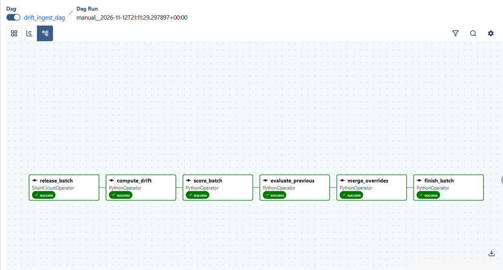

# Distillate: Model Pipeline

This README documents Phase 2 of Distillate (the model pipeline): teacher labels, the student's training, evaluation, the gate, the model registry and CI. The data pipeline is documented in `Data-Pipeline/README.md`.

## Contents

In pipeline order; each lane fills in its section.

1. Teacher and soft labels (Nishaant)
2. Teacher labels, data loading and EDA (Praniti)
3. Student training and tuning (Shivam)
4. Evaluation, gate and bias (Ruchita)
5. CI/CD, registry and rollback (Vaishnavi)
6. Monitoring preparation (Sai)

## 2. Teacher labels, data loading and EDA (Praniti)

Everything the student trains and is evaluated on goes through three steps: the teacher's shards are **validated**, **merged** into one table, and **loaded** with the processed splits by a single function. An EDA notebook compares the teacher's labels with the gold labels, and `drift_ingest_dag` starts the Phase 3 drift stream.

### 2.1 Validating the teacher's shards (`Data-Pipeline/scripts/validate_teacher_shards.py`)

Before anything reads the teacher's output, the stage checks every run in `gs://distillate-mlops-data` (Hugging Face `distillate-team/distillate-teacher-shards` is the backup) against the teacher shard spec (`Model-Pipeline/docs/teacher_prompts_and_shard_spec.md`, section 6). It reuses the teacher lane's own validator (`src.teacher.validate_local`), so the checks have one implementation.

| Run | Shards | Rows |
|---|---|---|
| raw teacher: train / gate / drift | 32 / 4 / 20 | 159,571 / 20,000 / 40,000 |
| stack soft labels: train / gate / drift | 32 / 4 / 20 | 159,571 / 20,000 / 40,000 |
| calibrated Qwen: train / gate | 32 / 4 | 159,571 / 20,000 |

All eight runs pass with 0 errors. On top of the spec's checks, every manifest's fingerprint must match the committed frozen artifact: `stack_sha256` against `artifacts/stack/stack_p2-zs-v2b.json`, and `calibration_sha256` against `artifacts/pilot/calibration_p2-zs-v2b.json` (hashed with line endings normalized, so a Windows checkout gives the same hash). Training runs are checked against the committed shard plan, and drift runs against `Data-Pipeline/data/splits/civil_drift_ids.csv`, one shard per batch.

The result is written to `Data-Pipeline/reports/teacher/validation.json`. Any error fails the stage with `TeacherShardError`. If the store can't be reached (no credentials, as on a fresh clone or in CI), the stage warns and skips instead of failing the DAG; `teacher.required: true` makes that a failure. A missing package fails loudly rather than counting as an unreachable store. All settings are in the `teacher:` section of `Data-Pipeline/config/pipeline.yaml`.

### 2.2 The merged table (`Data-Pipeline/scripts/merge_teacher_labels.py`)

`Data-Pipeline/data/processed/teacher_labels.parquet` has one row per raw Wikipedia training id (159,571), joined by id from four sources, and is versioned with `Data-Pipeline/data/processed.dvc`:

| Columns | Source | Use |
|---|---|---|
| `p_<label>` | stack-v1 soft labels | **the student's targets** |
| `p_<label>_raw` | raw Qwen | audit; never a training target |
| `tfidf_oof_<label>` | out-of-fold TF-IDF | the TF-IDF ablation arm |
| `p_<label>_calqwen` | calibrated Qwen | the attribution arm |
| `prompt_version`, `model_version`, `teacher_version` | the soft labels | lineage |

The merge runs only if validation passed (it reads the validation report), checks the TF-IDF file against its committed manifest (SHA-256, row count, id hash, version), requires every source to hold exactly the same ids once each, and fails without writing anything if any training row lacks a soft label. There are no gate or drift rows. Sanity check: the mean `p_toxicity` is 0.096, the same as the gold rate. The columns are also in `Data-Pipeline/CONTRACTS.md`.

### 2.3 Loading data (`src/data/load_data.py`)

One call returns the tables, with the teacher labels joined onto train and validation by id (rows dedupe removed drop out):

```python
from src.data.load_data import load_data

data = load_data(tables=("train", "val"))   # training: only what it needs
data = load_data()                          # every table
data = load_data(rev="<git commit>")        # the data exactly as that commit versioned it, through DVC

data["train"], data["val"]      # gold <label> (0/1), targets p_<label>, sample_weight, the arms' columns
data["gate"], data["h2"], data["bias"], data["obfuscation"]   # evaluation tables, no teacher columns
data.train_data_hash            # SHA-256 over train, val and teacher_labels: log it with data.rev to MLflow
data.data_hash                  # SHA-256 over every file read
data.teacher_versions           # prompt / model / teacher versions
```

| Table | Rows |
|---|---|
| train / val | 132,388 / 21,363 (train + val + the 2,000-row canary = the 155,751 deduplicated rows) |
| gate | 63,978 |
| h2 / bias | 10,000 / 21,577 |
| obfuscation | 3,000 |

`train_data_hash` covers only what training reads, so changing an evaluation table doesn't change a training run's lineage. Reading through DVC at a commit gives the same hash as reading the same files from disk. Loading stops with a clear error if any train or validation row is missing any teacher column (a count per column is reported), and a missing file raises `FileNotFoundError` with or without `rev=`.

**Setup.** `load_data()` reads `Data-Pipeline/data/processed/`, so get the data first, from `Data-Pipeline/`:

```bash
gcloud auth application-default login   # once, with an account that has bucket access
dvc pull
```

`rev=` also needs DVC in the environment (`pip install "dvc[gs]"`). The Google Cloud Storage client needs a project: set `GOOGLE_CLOUD_PROJECT` to the team project if it complains that no project could be determined. On macOS with the python.org Python, DVC may report "object ... is corrupted" when the real cause is an SSL certificate failure; this fixes it:

```bash
export SSL_CERT_FILE=$(python -c "import certifi; print(certifi.where())")
```

Linux, Docker and Kaggle aren't affected.

### 2.4 EDA: teacher vs gold (`notebooks/eda_teacher_vs_gold.ipynb`)

Compares the four score sources with the gold labels on train + validation (153,751 rows). Figures are in `docs/images/eda/`; the notebook shows no comment text.

- **Ranking:** the stack has the highest AUC and PR-AUC on every label (mean AUC 0.990; TF-IDF 0.985; raw Qwen 0.974), matching the teacher lane's reported results. Its lead is largest on rare labels (threat PR-AUC 0.589 vs 0.272 for raw Qwen).
- **Calibration:** the stack is the best calibrated source overall (ECE 0.003 vs 0.076 for raw Qwen). Raw Qwen over-predicts every label except obscene (toxicity 0.224 vs a gold rate of 0.096).
- **Length:** longer comments are harder for every source; raw Qwen's false-alarm rate at 0.5 doubles from short to long comments (10.1% to 20.1%).
- **Identity mention:** the stack's ranking holds up best on comments that mention an identity term (AUC drop 0.016 vs 0.057 for raw Qwen). At thresholds matched to the same overall false-alarm rate, every source flags clean identity-mentioning comments 2.3–4.1× as often as other clean comments (at 1%: stack 2.9×, raw Qwen 3.7×). The stack's skew is somewhat smaller than raw Qwen's, but substantial for every source, so the student's bias check should watch this slice. (A fixed 0.5 comparison would mix calibration with bias.)
- **Truncation (distilbert-base-uncased):** 18.3% of comments exceed 128 tokens (11.2% of toxic ones) and 6.4% exceed 256 (4.1%), consistent with the sweep's choice of `max_length = 256`.

### 2.5 Drift ingestion skeleton (`Data-Pipeline/dags/drift_ingest_dag.py`)

`drift_ingest_dag` releases the Civil drift stream (20 time-ordered batches of 2,000) one batch per run, as six tasks:



| Task | Phase 2 (now) | Phase 3 |
|---|---|---|
| `release_batch` | checks batch k's schema, size and ids against `civil_drift_ids.csv`; once all 20 are done, evaluates the last batch (once) and skips the rest | same |
| `compute_drift` | basic statistics (stub) | `src/monitoring/drift.py` (PSI) |
| `score_batch` | `POST /predict` (v4 §2.4) against a mock with the same response format; stores ids, text hashes and scores, never text | the live endpoint (`drift_ingest.service_url`), with batched or parallel requests and per-request retries |
| `evaluate_previous` | AUC and F1 per label for the previous batch, with its delayed gold labels | same |
| `merge_overrides` | stub | moderation-queue overrides from the GCS feedback log |
| `finish_batch` | writes the batch record and moves the stream on | same, with the stream state kept in GCS |

The DAG is created paused and is scheduled only when `drift_ingest.enabled` is true (`schedule: demo` every 5 minutes, `real` weekly), so it never advances the stream by itself. Run one batch outside Airflow with `python -m scripts.drift_ingest` (from `Data-Pipeline/`). Outputs go to `Data-Pipeline/reports/drift/` (git-ignored). Rare labels have very few positives per batch (for example 4 threats in 2,000), so per-batch AUCs for them are noisy.

### 2.6 Tests

- `Data-Pipeline/tests/test_validate_teacher_shards.py` (8) and `test_merge_teacher_labels.py` (7): the teacher lane's fixtures (valid shards pass, a broken one gives exactly one error), wrong fingerprints, unreachable store and missing package, the contract table, TF-IDF manifest mismatches, missing soft labels, and failed, skipped or missing validation reports.
- `Model-Pipeline/tests/data/test_load_data.py`: every table, teacher columns only on train/val, missing teacher scores per column, `tables=`, the two hashes, a missing file, and `rev=` through a stubbed DVC.
- `Data-Pipeline/tests/test_drift_ingest.py` (8): one batch per run and evaluation of the previous one, the last batch evaluated once the stream is finished, no text in predictions, the §2.4 response format, flags and `low_confidence`, wrong ids, missing columns, a missing batch file.

All use small made-up data and no network.
