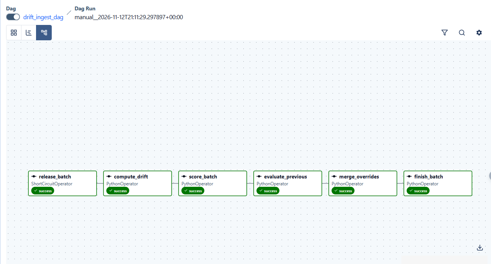

# Distillate: Model Pipeline

This README documents Phase 2 of Distillate (the model pipeline): teacher labels, the student's training, evaluation, the gate, the model registry and CI. The data pipeline is documented in `Data-Pipeline/README.md`.

## Contents

In pipeline order; each lane fills in its section.

1. Teacher and soft labels (Nishaant)
2. Teacher labels, data loading and EDA (Praniti)
3. Student training and tuning (Shivam)
4. Evaluation, gate and bias (Ruchita)
5. CI/CD, registry and rollback (Vaishnavi)
6. Monitoring preparation (Sai)

## 2. Teacher labels, data loading and EDA (Praniti)

Everything the student trains and is evaluated on goes through three steps: the teacher's shards are **validated**, **merged** into one table, and **loaded** with the processed splits by a single function. An EDA notebook compares the teacher's labels with the gold labels, and `drift_ingest_dag` starts the Phase 3 drift stream.

### 2.1 Validating the teacher's shards (`Data-Pipeline/scripts/validate_teacher_shards.py`)

Before anything reads the teacher's output, the stage checks every run in `gs://distillate-mlops-data` (Hugging Face `distillate-team/distillate-teacher-shards` is the backup) against the teacher shard spec (`Model-Pipeline/docs/teacher_prompts_and_shard_spec.md`, section 6). It reuses the teacher lane's own validator (`src.teacher.validate_local`), so the checks have one implementation.

| Run | Shards | Rows |
|---|---|---|
| raw teacher: train / gate / drift | 32 / 4 / 20 | 159,571 / 20,000 / 40,000 |
| stack soft labels: train / gate / drift | 32 / 4 / 20 | 159,571 / 20,000 / 40,000 |
| calibrated Qwen: train / gate | 32 / 4 | 159,571 / 20,000 |

All eight runs pass with 0 errors. On top of the spec's checks, every manifest's fingerprint must match the committed frozen artifact: `stack_sha256` against `artifacts/stack/stack_p2-zs-v2b.json`, and `calibration_sha256` against `artifacts/pilot/calibration_p2-zs-v2b.json` (hashed with line endings normalized, so a Windows checkout gives the same hash). Training runs are checked against the committed shard plan, and drift runs against `Data-Pipeline/data/splits/civil_drift_ids.csv`, one shard per batch.

The result is written to `Data-Pipeline/reports/teacher/validation.json`. Any error fails the stage with `TeacherShardError`. If the store can't be reached (no credentials, as on a fresh clone or in CI), the stage warns and skips instead of failing the DAG; `teacher.required: true` makes that a failure. A missing package fails loudly rather than counting as an unreachable store. All settings are in the `teacher:` section of `Data-Pipeline/config/pipeline.yaml`.

### 2.2 The merged table (`Data-Pipeline/scripts/merge_teacher_labels.py`)

`Data-Pipeline/data/processed/teacher_labels.parquet` has one row per raw Wikipedia training id (159,571), joined by id from four sources, and is versioned with `Data-Pipeline/data/processed.dvc`:

| Columns | Source | Use |
|---|---|---|
| `p_<label>` | stack-v1 soft labels | **the student's targets** |
| `p_<label>_raw` | raw Qwen | audit; never a training target |
| `tfidf_oof_<label>` | out-of-fold TF-IDF | the TF-IDF ablation arm |
| `p_<label>_calqwen` | calibrated Qwen | the attribution arm |
| `prompt_version`, `model_version`, `teacher_version` | the soft labels | lineage |

The merge runs only if validation passed (it reads the validation report), checks the TF-IDF file against its committed manifest (SHA-256, row count, id hash, version), requires every source to hold exactly the same ids once each, and fails without writing anything if any training row lacks a soft label. There are no gate or drift rows. Sanity check: the mean `p_toxicity` is 0.096, the same as the gold rate. The columns are also in `Data-Pipeline/CONTRACTS.md`.

### 2.3 Loading data (`src/data/load_data.py`)

One call returns the tables, with the teacher labels joined onto train and validation by id (rows dedupe removed drop out):

```python
from src.data.load_data import load_data

data = load_data(tables=("train", "val"))   # training: only what it needs
data = load_data()                          # every table
data = load_data(rev="<git commit>")        # the data exactly as that commit versioned it, through DVC

data["train"], data["val"]      # gold <label> (0/1), targets p_<label>, sample_weight, the arms' columns
data["gate"], data["h2"], data["bias"], data["obfuscation"]   # evaluation tables, no teacher columns
data.train_data_hash            # SHA-256 over train, val and teacher_labels: log it with data.rev to MLflow
data.data_hash                  # SHA-256 over every file read
data.teacher_versions           # prompt / model / teacher versions
```

| Table | Rows |
|---|---|
| train / val | 132,388 / 21,363 (train + val + the 2,000-row canary = the 155,751 deduplicated rows) |
| gate | 63,978 |
| h2 / bias | 10,000 / 21,577 |
| obfuscation | 3,000 |

`train_data_hash` covers only what training reads, so changing an evaluation table doesn't change a training run's lineage. Reading through DVC at a commit gives the same hash as reading the same files from disk. Loading stops with a clear error if any train or validation row is missing any teacher column (a count per column is reported), and a missing file raises `FileNotFoundError` with or without `rev=`.

**Setup.** `load_data()` reads `Data-Pipeline/data/processed/`, so get the data first, from `Data-Pipeline/`:

```bash
gcloud auth application-default login   # once, with an account that has bucket access
dvc pull
```

`rev=` also needs DVC in the environment (`pip install "dvc[gs]"`). The Google Cloud Storage client needs a project: set `GOOGLE_CLOUD_PROJECT` to the team project if it complains that no project could be determined. On macOS with the python.org Python, DVC may report "object ... is corrupted" when the real cause is an SSL certificate failure; this fixes it:

```bash
export SSL_CERT_FILE=$(python -c "import certifi; print(certifi.where())")
```

Linux, Docker and Kaggle aren't affected.

### 2.4 EDA: teacher vs gold (`notebooks/eda_teacher_vs_gold.ipynb`)

Compares the four score sources with the gold labels on train + validation (153,751 rows). Figures are in `docs/images/eda/`; the notebook shows no comment text.

- **Ranking:** the stack has the highest AUC and PR-AUC on every label (mean AUC 0.990; TF-IDF 0.985; raw Qwen 0.974), matching the teacher lane's reported results. Its lead is largest on rare labels (threat PR-AUC 0.589 vs 0.272 for raw Qwen).
- **Calibration:** the stack is the best calibrated source overall (ECE 0.003 vs 0.076 for raw Qwen). Raw Qwen over-predicts every label except obscene (toxicity 0.224 vs a gold rate of 0.096).
- **Length:** longer comments are harder for every source; raw Qwen's false-alarm rate at 0.5 doubles from short to long comments (10.1% to 20.1%).
- **Identity mention:** the stack's ranking holds up best on comments that mention an identity term (AUC drop 0.016 vs 0.057 for raw Qwen). At thresholds matched to the same overall false-alarm rate, every source flags clean identity-mentioning comments 2.3–4.1× as often as other clean comments (at 1%: stack 2.9×, raw Qwen 3.7×). The stack's skew is somewhat smaller than raw Qwen's, but substantial for every source, so the student's bias check should watch this slice. (A fixed 0.5 comparison would mix calibration with bias.)
- **Truncation (distilbert-base-uncased):** 18.3% of comments exceed 128 tokens (11.2% of toxic ones) and 6.4% exceed 256 (4.1%), consistent with the sweep's choice of `max_length = 256`.

### 2.5 Drift ingestion skeleton (`Data-Pipeline/dags/drift_ingest_dag.py`)

`drift_ingest_dag` releases the Civil drift stream (20 time-ordered batches of 2,000) one batch per run, as six tasks:



| Task | Phase 2 (now) | Phase 3 |
|---|---|---|
| `release_batch` | checks batch k's schema, size and ids against `civil_drift_ids.csv`; once all 20 are done, evaluates the last batch (once) and skips the rest | same |
| `compute_drift` | basic statistics (stub) | `Data-Pipeline/scripts/drift.py` (PSI; section 6.1) |
| `score_batch` | `POST /predict` (v4 §2.4) against a mock with the same response format; stores ids, text hashes and scores, never text | the live endpoint (`drift_ingest.service_url`), with batched or parallel requests and per-request retries |
| `evaluate_previous` | AUC and F1 per label for the previous batch, with its delayed gold labels | same |
| `merge_overrides` | stub | moderation-queue overrides from the GCS feedback log |
| `finish_batch` | writes the batch record and moves the stream on | same, with the stream state kept in GCS |

The DAG is created paused and is scheduled only when `drift_ingest.enabled` is true (`schedule: demo` every 5 minutes, `real` weekly), so it never advances the stream by itself. Run one batch outside Airflow with `python -m scripts.drift_ingest` (from `Data-Pipeline/`). Outputs go to `Data-Pipeline/reports/drift/` (git-ignored). Rare labels have very few positives per batch (for example 4 threats in 2,000), so per-batch AUCs for them are noisy.

### 2.6 Tests

- `Data-Pipeline/tests/test_validate_teacher_shards.py` (8) and `test_merge_teacher_labels.py` (7): the teacher lane's fixtures (valid shards pass, a broken one gives exactly one error), wrong fingerprints, unreachable store and missing package, the contract table, TF-IDF manifest mismatches, missing soft labels, and failed, skipped or missing validation reports.
- `Model-Pipeline/tests/data/test_load_data.py`: every table, teacher columns only on train/val, missing teacher scores per column, `tables=`, the two hashes, a missing file, and `rev=` through a stubbed DVC.
- `Data-Pipeline/tests/test_drift_ingest.py` (8): one batch per run and evaluation of the previous one, the last batch evaluated once the stream is finished, no text in predictions, the §2.4 response format, flags and `low_confidence`, wrong ids, missing columns, a missing batch file.

All use small made-up data and no network.

## 3. Student training and tuning (Shivam)

The student is a small encoder with six sigmoid outputs, one per label. It is distilled from the stack's soft labels (section 1) and the gold labels, with the mixed recipe tuned once in an Optuna study. Eight arms are then trained under identical conditions, and one is selected by a fixed rule. The details are in four documents:

| Document | What it covers |
|---|---|
| [`docs/student.md`](docs/student.md) | The training harness: the loss, data and split, run outputs, thresholds and the ONNX model package |
| [`docs/tuning.md`](docs/tuning.md) | The Optuna study: search space, sampler, budget, the two workers' merged study, the best values and the 5-epoch check |
| [`docs/pipeline.md`](docs/pipeline.md) | The single entry point `python -m src.pipeline.run`, the selection rule, the results across arms and where it all runs (Kaggle, Docker, locally) |
| [`reports/student/phase2/README.md`](reports/student/phase2/README.md) | The reported run: every arm on every evaluation set, the selection and the findings |

### 3.1 Training (`src/student/`)

```text
loss = α · BCE(student, gold) + (1 − α) · T² · BCE(student / T, stack / T)
```

The gold term carries `sample_weight`, and rows with a failed soft label are left out of the soft term. Each run keeps its best epoch on validation and tunes one threshold per label on validation (the best F1). It then builds the ONNX package (`model.onnx`, `tokenizer/`, `thresholds.json`, `meta.json` with lineage and file hashes) and stops if ONNX and PyTorch differ by more than 1e-3. Everything is logged to MLflow. Settings are in `configs/student.yaml`.

### 3.2 Tuning (`src/student/sweep.py`, `kaggle/11_student_runs.ipynb`)

One Optuna study (TPE) tuned α, T, learning rate, epochs and maximum length on DistilBERT with the mixed loss. The objective was validation mean AUC; the gate set was never read. The study ran 28 trials over two workers on Kaggle T4s (Shivam and Nishaant) and is stored at `gs://distillate-mlops-data/optuna/distilbert-mixed-v1.db`.

**Best values (trial 26):** α 0.343, T 3.71, learning rate 9.23e-5, 4 epochs, 256 tokens; validation mean AUC 0.99364. 256 tokens won clearly (the top 21 trials). The top three trials are within 0.00004 AUC of each other, so the best values mark a region rather than one point. Every trial peaked at its last epoch, so a check run at 5 epochs was added. It gained +0.0002 on validation (the noise level) and nothing on the gate set or H2.

### 3.3 The reported run (`kaggle/13_student_ablation_all.ipynb`)

All eight arms ran through `src.pipeline.run` with the tuned values in one Kaggle session on T4 x2 (5.9 hours, code `80a4502`, seed 42, the official split). Each arm was trained, then scored on validation, the gate set (H1), Civil H2, the Civil bias set and the obfuscated comments, then checked for bias, timed on CPU and plotted. Mean AUC with 95% bootstrap intervals:

| Arm | Validation | Gate (H1) | Civil (H2) |
|---|---|---|---|
| gold only (α = 1) | 0.98937 | 0.9841 [0.9831, 0.9849] | 0.9139 [0.8993, 0.9285] |
| stack only (α = 0) | 0.99303 | 0.9835 [0.9826, 0.9842] | 0.9359 [0.9225, 0.9471] |
| mixed (the tuned recipe) | 0.99348 | 0.9848 [0.9840, 0.9854] | 0.9410 [0.9280, 0.9510] |
| TF-IDF soft labels | 0.99426 | 0.9826 [0.9815, 0.9835] | 0.9081 [0.8895, 0.9252] |
| calibrated-Qwen soft labels | 0.98834 | 0.9783 [0.9771, 0.9793] | 0.9206 [0.9055, 0.9350] |
| **mixed, 5 epochs (selected)** | 0.99368 | 0.9845 [0.9836, 0.9852] | 0.9399 [0.9263, 0.9502] |
| MiniLM-L12, mixed | 0.99187 | 0.9849 [0.9841, 0.9857] | 0.9438 [0.9336, 0.9524] |
| ModernBERT-base, mixed | 0.99349 | 0.9846 [0.9839, 0.9853] | 0.9384 [0.9233, 0.9498] |

- **Distillation (H2):** mixed vs gold only, +0.027 [+0.013, +0.041] on Civil. On the gate set the AUC gain is small (+0.0007) and within the effect of the shared recipe; the PR-AUC gain (+0.064) is large.
- **What the LLM adds:** stack vs TF-IDF soft labels, +0.028 [+0.018, +0.038] on H2.
- **Every arm passes the bias check.**
- **The thresholds don't transfer to Civil:** H2 AUC is 0.94, but toxicity recall at the validation thresholds is 38%. Phase 3 sets thresholds for news-comment traffic.
- **Latency:** no fp32 package meets the 50 ms p95 budget (DistilBERT 144 ms, MiniLM 103 ms). The budget applies to the int8 package in Phase 3.

### 3.4 Selection (`src/student/select_best.py`)

The rule: among the candidates that pass the bias check, the highest validation mean AUC, with runs within 0.0002 counted as tied and the tie broken by PR-AUC. The gate set and H2 never choose. Two settings were decided after the run and are recorded in `configs/student.yaml`:

1. Only the tuned recipe competes: DistilBERT at 4 and 5 epochs, MiniLM-L12 and ModernBERT. The other arms are the ablation's controls.
2. Latency is reported, not enforced.

**Selected: `distilbert-mixed-5ep`** (`student-distilbert-mixed-5ep-20261112T210931Z`, MLflow run `358772663fc34a5e81275c3ed073e598`). It ties ModernBERT on validation AUC and wins on PR-AUC (0.7678). The three candidates are within noise of each other, so the choice is the rule's, not a measured difference. Its package and every arm's prediction files are in `gs://distillate-mlops-data/models/student-distilbert-mixed-5ep-20261112T210931Z/` (`selected_package/` and `phase2_results.zip`). The model card's section 4 describes the training in full.

### 3.5 Running it

```bash
# from Model-Pipeline/, offline on the tiny model
python -m src.student.synthetic --out outputs/synthetic
python -m src.student.train --config configs/smoke.yaml
pytest tests/student tests/pipeline

# one arm through the whole pipeline (needs the data, section 2.3)
python -m src.pipeline.run --set run_name=distilbert-mixed

# the training image, from the repository root
docker build -f Model-Pipeline/Dockerfile -t distillate-train .
```

The image pins every version (`requirements-pipeline.txt`, CUDA 12.6 torch). CI builds it whenever it can change and runs `src.pipeline.container_check` and `tests/pipeline` inside it (`.github/workflows/model-pipeline-image.yml`).

### 3.6 Tests

`tests/student/` and `tests/pipeline/` (100 tests): the loss, thresholds, the package and its parity check, the sweep's shared-study guard, MLflow logging, the evaluation tables, the selection rule, and every pipeline step end to end on a tiny model. All run offline with made-up data.

## 6. Monitoring preparation (Sai)

Builds on #45 (drift metrics), #50 (canary) and #52 (dashboards and alert rules); this section describes their code, so it merges after them.

Phase 2 builds the monitoring pieces against mocks (v4 §5), so Phase 3 only points them at the live endpoint: **drift metrics** for each batch of the Civil stream, a **canary** that replays labeled comments through the service, and **dashboards and alert rules** with documented thresholds.

### 6.1 Drift metrics (`Data-Pipeline/scripts/drift.py`)

Each drift batch is compared with a baseline from the model's training data (Wikipedia train) using the population stability index (PSI). For the three input features, the baseline is split into equal-count bins (deciles), and PSI compares the batch's share of comments in each bin with the baseline's; `flag_rate` is a two-bin PSI (flagged or not) against a reference rate. 0 means no change; status is `ok` below 0.1, `warn` from 0.1, and `alert` from 0.25 (the usual rules of thumb, in the `drift:` section of `Data-Pipeline/config/pipeline.yaml`).

| Feature | Measures | When |
|---|---|---|
| `char_len` | comment length | before scoring (`input_drift`) |
| `oov_rate` | share of a comment's words not seen at least twice in training | before scoring |
| `nonalpha_share` | share of non-space characters that aren't letters | before scoring |
| `flag_rate` | share of comments the model flags | after scoring (`flag_rate_drift`) |

Phase 3 wiring (`compute_drift` in `drift_ingest_dag` is still a stub, section 2.5):

```python
from scripts import drift

baseline = drift.load_baseline(cfg)                        # built by data_prep_dag
drift.input_drift(batch, baseline, cfg)                    # in compute_drift
drift.flag_rate_drift(predictions, reference_rate, cfg)    # in score_batch, after scoring
```

The baseline is built by the `drift_baseline` stage of `data_prep_dag`, after `split` and before `dvc_version`, so it is versioned in the same DVC commit as the data it describes; the drift DAG only loads it, and a missing baseline is an error. It stores bin edges, shares and means, and the vocabulary as truncated BLAKE2b hashes of single words: no comment text. The file lives at `Data-Pipeline/scripts/drift.py`, not the plan's `src/monitoring/drift.py`, so it imports as `scripts.drift` like the rest of Data-Pipeline and doesn't collide with Model-Pipeline's `src` package.

**On the real data:** the baseline from 132,388 Wikipedia train comments has 76,508 known words and builds in 17 s. Against it, all 20 Civil drift batches show:

| Feature | PSI across the 20 batches | Civil vs Wikipedia | Status |
|---|---|---|---|
| Length | 0.004 to 0.035 | ~295 vs 380 characters, similar distribution | ok |
| OOV rate | 0.05 to 0.13 | 1.9% vs 1.3% unfamiliar words | ok to warn |
| Non-alpha share | 0.11 to 0.18 | 5.4% vs 7.4% (talk pages carry markup, timestamps, signatures) | warn in every batch |

Every batch is `warn`, none reaches `alert`, and there is no trend from batch 0 to batch 19 (the teacher lane's `Model-Pipeline/artifacts/stack/drift_check.json` shows the same). That is the Wikipedia-to-Civil domain shift, not drift within the stream, which shapes the alert rules (6.4).

### 6.2 Canary replay (`Data-Pipeline/scripts/canary.py`)

Real traffic has no labels, so the canary replays the labeled canary sets (`canary_wikipedia`, 2,000 comments, and `canary_civil`, 4,000) through any service following the serving API (v4 §2.4) and compares the answers with the known labels: AUC (from `scores`) and F1 (from `flagged`) per label, plus the precision, recall, F1 and false positive rate of the service's `flag`. Civil covers five labels (no `severe_toxicity`, v4 §2.2).

```bash
python -m scripts.canary --url http://127.0.0.1:8000    # from Data-Pipeline/
```

- **Checks first:** `GET /health` must answer `ok`, so a down service fails before any comment is sent.
- **Bad answers:** a failed call, or a response that breaks the API (including a score that isn't a finite number in [0, 1]), counts as an error and is left out of the metrics. More than 1% errors fails the run, and the CLI then sends a `fail` alert.
- **Outputs (no comment text):** `reports/canary/canary_report.json`, and the same metrics in Prometheus format, `reports/canary/canary.prom`, for the dashboards. A run that sees two model versions (a rollout mid-run) logs a warning.
- **Use `127.0.0.1`, not `localhost`,** on Windows: `localhost` tries IPv6 first, about 2 s per request.

Against the mock (6.3), all 6,000 real canary comments are scored in about 4 s with no errors. The mock's scores carry no signal, so the AUCs (Wikipedia 0.509) only test the plumbing. They come from a hash of each comment's text, so they're deterministic, and the canary's AUCs are identical on every run, as the alert design relies on.

### 6.3 Dashboards and alert rules (`Deployment/monitoring/`)

| File | What it is |
|---|---|
| `mock_service.py` | Mock of the §2.4 service: `/predict`, `/health`, and `/metrics` with exactly the §2.4 metric names, counted from real traffic, plus the canary's `.prom` file. Flags about 11% of comments; bad input is a 422, not counted as a service error |
| `prometheus/alert_rules.yml` | The **active** rules (9, service health and canary), using only metrics that exist today; Prometheus loads it |
| `prometheus/alert_rules_planned.yml` | The **planned** rules (7), not loaded until Phase 3 provides what they need: latency (the int8 package's p95), the canary retrain rule (the promoted model's reference AUC) and drift (`drift_ingest_dag`'s metrics). All three `action: retrain` rules are here |
| `prometheus/alert_rules_test.yml` | `promtool` unit tests: no flag-rate alert when traffic goes idle, service down fires, a missing canary fires |
| `grafana/dashboards/distillate_dashboard.json` | v4 §6's panels: p50/p90/p95 latency, RPS, errors, flag rates, low confidence, canary AUC and flag precision/recall, drift PSI, delayed-label AUC; panels that need Phase 3 metrics are titled "(planned)", and instances and gate history are placeholders |
| `thresholds.md` | every threshold and why (6.4) |
| `docker-compose.yml` | Prometheus and Grafana, to view the drafts locally |

**Verified end to end:** `promtool check rules` finds 9 valid active and 7 valid planned rules, and `promtool test rules` passes. On the local stack, Prometheus scrapes the mock (target UP), evaluates the active rules with no errors (all inactive on the healthy mock), and Grafana loads the dashboard with data in every service, decision and canary panel; the planned drift panels stay empty until `drift_ingest_dag` exports its metrics in Phase 3. `.github/workflows/monitoring-ci.yml` runs the tests, ruff and both `promtool` checks on every PR that touches the folder. How to run it: `Deployment/monitoring/README.md`.

### 6.4 Alert thresholds (`Deployment/monitoring/thresholds.md`)

| Alert | Threshold | Why |
|---|---|---|
| Canary AUC drop | 0.02 below a reference, for 3 runs | The canary replays the same comments, so an unchanged model gives an identical AUC every run; a drop means the service changed. 0.02 is about 2 standard errors of the Wikipedia canary's AUC; 3 runs rides out a transient failure. Active against the 7-day average, **notify only** (after a legitimate promotion it would keep firing for days); the **retrain** version (planned) compares with the promoted model's own canary AUC |
| Delayed-label AUC drop (planned) | 0.03 below its 7-day average | Each drift batch is new comments, so noise is real (about ±0.04 for one batch); the rule uses the mean of two batches (about ±0.03). Retrains |
| Input drift (planned) | warn 0.1, alert 0.25, against the **start of the Civil stream** | Against Wikipedia every Civil batch is already `warn` (6.1), so a warning there would fire permanently. Alert retrains |
| Drift beyond the known shift (planned) | 0.25 against Wikipedia | The known shift tops out near 0.18, so 0.25 means traffic unlike anything measured |
| Flag-rate drift (planned) | 0.25, against a Civil reference | Wikipedia thresholds don't transfer to Civil (toxicity recall 38% on H2, 3.3) |
| Service (active) | errors 2% / 5% (service-side only); flag rate outside 0.5x to 2x its 7-day average, only with real traffic | Bad client input doesn't count as an error; with no traffic the flag-rate ratio is 0, so without the traffic guard it would fire every quiet night. A halving or doubling of what gets flagged is worth a look before any labels arrive |
| Latency (planned) | p95 50 ms (the int8 package, 3.3) | v4 §6's target applies to the int8 package: the measured fp32 p95 is 144 ms (3.3), so against fp32 it would fire constantly. Activates once the int8 p95 is measured |
| Canary missing or stale (active) | no run in 2 hours, or no canary series at all | `absent()` catches a series that disappears entirely, which the staleness check can't see |

**Open for Phase 3:** the canary's mean AUC is fragile on rare labels. `canary_civil` has only 3 threat, 12 obscene and 14 identity_attack positives (against 286 for toxicity); with the mock's signal-free scores, threat landed at AUC 0.25 by chance and pulled the Civil mean to 0.42. Before the canary alert retrains anything, it should use a positives-weighted mean or toxicity AUC. The `civil_start` drift reference should be built from the first few batches or `canary_civil`, since 2,000 comments is a thin vocabulary for the OOV feature.

### 6.5 Tests

- `Data-Pipeline/tests/test_drift.py` (16): PSI is 0 for identical distributions and stays finite with empty bins; each feature on known text; the baseline stores no words and is deterministic; a missing baseline is an error by default; a batch like training data shows no drift, while a shifted one alerts on every feature; flag-rate drift; JSON-ready results.
- `Data-Pipeline/tests/test_canary.py` (23), against a local HTTP server following §2.4: a perfect service scores perfectly; five Civil labels; the Prometheus file parses; no comment text in the outputs; failed calls and bad responses, including NaN, out-of-range and non-numeric scores; a down service fails the health check before any replay; the CLI alerts on failure; mixed model versions warn.
- `Deployment/monitoring/tests/` (22): the mock follows §2.4 (response shape, every metric name, counters following the traffic, cumulative histograms, no text in metrics), rejects bad input such as a lone surrogate as a counted 422, counts its own failures as 500s, and resolves a p95 near 144 ms; active rules and unplanned panels use only metrics that exist, with the canary's names read from `canary.py`; no active rule can retrain; the thresholds doc covers every rule. Plus `prometheus/alert_rules_test.yml` (`promtool test rules`).

All use small made-up data and no network beyond the local machine.
