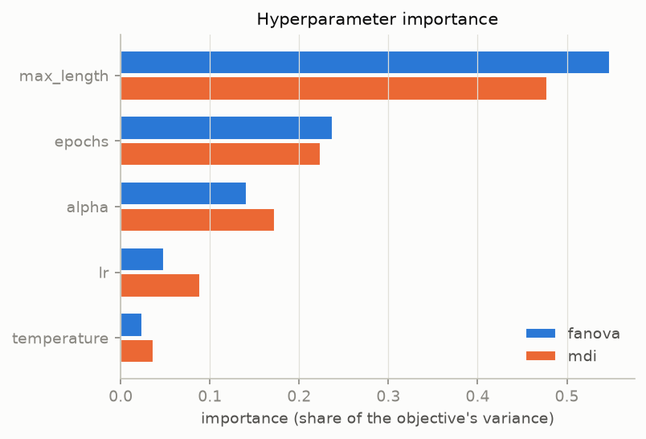
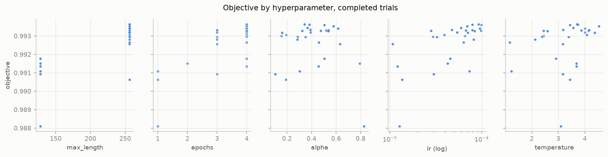
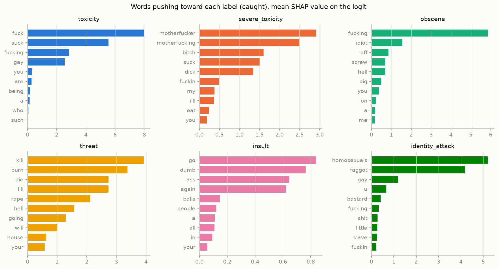
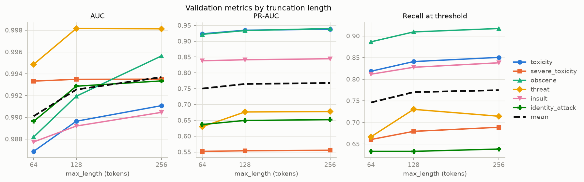
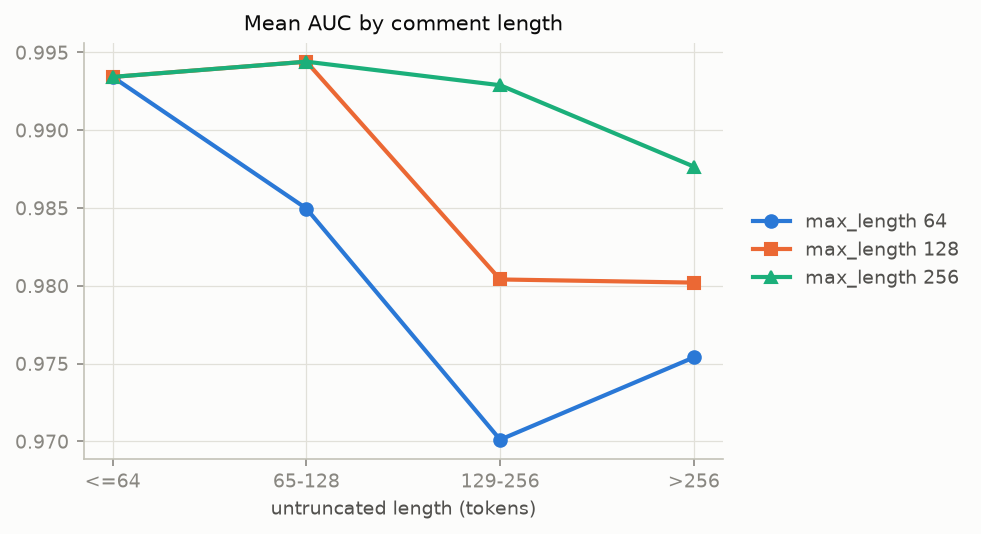
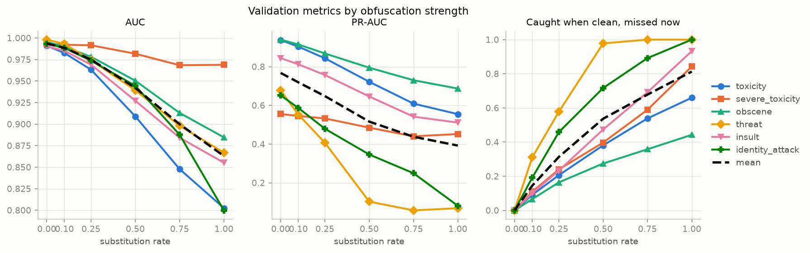

# Sensitivity analysis: `student-distilbert-mixed-5ep-20261112T210931Z`

Generated by `python -m src.sensitivity.run` from `results.json`; edit the findings file, not this one.

## Findings

Written by hand from the numbers below (run of 2026-11-13 on the selected student, 21,363 validation rows, 3 h 20 min on CPU). Everything is on validation, so these are diagnostics, not final numbers.

1. **The student's quality hardly depends on α and T inside the region it was tuned in.** Maximum length explains about half of the study's variance (fANOVA 0.548, MDI 0.478, first under all 11 seeds), then epochs (0.238 / 0.224); α (0.141 / 0.172), learning rate and T explain the rest. These are shares of a small variance: the 28 trials span validation mean AUC 0.988 to 0.9936. Maximum length leads because every 128-token trial scores below every good 256-token trial, and epochs mostly because of the 1-epoch trials. TPE sampled mostly near the best region, so α and T far from it are under-explored.

2. **Obfuscation is the student's clearest weakness, and it fails quietly.** Replacing characters with look-alikes (a→4, e→3, …) at rate 0.1, which changes 4.3% of characters, already makes it miss 14.5% of the toxic comments it caught when clean (mean over labels; toxicity 9.1%, threat 31%). At rate 0.5 (21% of characters) it misses 54% (toxicity 38%, threat 98%, identity_attack 72%), and mean AUC falls from 0.994 to 0.942. The flag rate falls with it (3.95% of comments clean, 2.44% at 0.5), so obfuscated text is passed as clean rather than flagged: attacks lower recall without raising false alarms. Threat, insult and identity_attack depend most on exact words; obscene is missed least (27% at 0.5). The fixed obfuscation set (toxic gate comments, several tricks at once) points the same way: toxicity recall 0.880 on the originals, 0.655 obfuscated (`reports/student/phase2/results.md`).

3. **Identity words push the student toward flagging, which matches the bias report.** In SHAP's false alarms for identity_attack, the most-attributed words are a racial slur (+7.3), "gay" (+5.2), "nazi" (+3.9) and "racist" (+2.8); "gay" also pushes caught toxicity comments up (+2.6). Comments that mention or discuss an identity, including ones that quote or report abuse, are scored as attacks. This is the mechanism behind the bias report's finding that the soft-label students flag more non-toxic comments mentioning race than the gold-only student does (section 9 of the model card). Threat false alarms work the same way: "kill" (+6.5) and "die" (+5.1) outside a threat.

4. **Missed toxic comments carry little attribution.** In the missed groups the top words have small attributions (toxicity: none above +0.7), and the masked examples are mostly insults without profanity ("smell like … poop"), toxicity carried by context, and identity attacks without a slur. The student relies on explicit words; implicit toxicity is its main source of false negatives on clean text.

5. **Truncating to 256 tokens costs little; 64 would cost the long comments.** At 256 tokens 6.4% of validation is truncated, and those comments score mean AUC 0.988 against 0.993 for the rest. Cutting to 64 tokens truncates 41% and lowers mean AUC by 0.004 overall (0.990), but by 0.023 on comments of 129 to 256 tokens (0.993 to 0.970); comments of 64 tokens or fewer are unaffected (0.993). A faster 64- or 128-token student would mainly lose long comments, a cost to weigh against latency in Phase 3.

Limits: SHAP is per label on 12 comments per outcome (211 comments in all), so the word tables show what drives these comments, not frequencies; a word must occur in at least 5 validation comments to be listed. The soft-label arms' validation numbers may be slightly optimistic (model card section 3, validation caveat), which affects levels here but not the comparisons across lengths and rates.

## Setup

|  | value |
|---|---|
| model_version | `student-distilbert-mixed-5ep-20261112T210931Z` |
| max_length (the model's own) | 256 |
| thresholds | the model's thresholds.json |
| validation rows | 21,363 (toxicity 2059, severe_toxicity 212, obscene 1136, threat 63, insult 1061, identity_attack 188) |
| validation data | `load_data`, DVC revision `5808fdf` |
| validation file sha256 | `a9ad613893969b11…` |
| code commit | `4deb14eec177cbbd0aede9630472d501453ce3f7` |
| seed | 42 |

All results are on **validation** (split roles: the gate set is for final numbers only). Metrics are unweighted. AUC and PR-AUC rank on the logits, because float32 probabilities tie at 1.0; ECE, Brier, recall and flag rate use the probabilities.

## 1. Hyperparameter importance

Study `distilbert-mixed-v1`: 28 completed trials of 28, objective maximized. Best trial 26: 0.9936 with alpha = 0.3433, temperature = 3.713, lr = 9.225e-05, epochs = 4, max_length = 256.

| parameter | fanova (range over seeds) | mdi (range over seeds) |
|---|---|---|
| max_length | 0.548 (0.367 to 0.548) | 0.478 (0.328 to 0.478) |
| epochs | 0.238 (0.238 to 0.341) | 0.224 (0.224 to 0.319) |
| alpha | 0.141 (0.104 to 0.229) | 0.172 (0.119 to 0.224) |
| lr | 0.049 (0.035 to 0.114) | 0.089 (0.066 to 0.144) |
| temperature | 0.024 (0.011 to 0.037) | 0.037 (0.028 to 0.059) |

The ranges come from recomputing both evaluators under 11 seeds (42 to 52, the first being the one above). `max_length` is ranked first in 11 of 11 (fanova) and 11 of 11 (mdi).

fANOVA is Optuna's default; MDI (a random forest's mean decrease in impurity) is an independent check on the ranking. Only parameters sampled in every completed trial are compared.

## 2. Token attributions (SHAP)

SHAP's partition explainer with the text masker (500 evaluations per comment), on the logits. Per label, up to 12 validation comments of each outcome at the threshold: caught (toxic, flagged), missed (toxic, not flagged) and false alarm (flagged, not toxic); 211 comments explained in all. Word pieces are merged into words. No comment text is shown: a word appears only if it occurs in at least 5 validation comments, and in the examples only the top 4 words are visible, never more than a third of a comment's words (`▒▒▒` is any run of hidden words).

Comments per label and outcome:

| label | caught (correct) | missed (incorrect) | false alarm (incorrect) |
|---|---|---|---|
| toxicity | 12 | 12 | 12 |
| severe_toxicity | 12 | 12 | 12 |
| obscene | 12 | 12 | 12 |
| threat | 12 | 12 | 12 |
| insult | 12 | 12 | 12 |
| identity_attack | 12 | 12 | 12 |

### toxicity

| rank | caught (correct) | missed (incorrect) | false alarm (incorrect) |
|---|---|---|---|
| 1 | fuck (+7.99) | offensive (+0.65) | u (+0.57) |
| 2 | suck (+5.56) | ever (+0.16) | get (+0.22) |
| 3 | fucking (+2.87) | rude (+0.13) | delete (+0.17) |
| 4 | gay (+2.56) | like (+0.12) | your (+0.14) |
| 5 | you (+0.32) | how (+0.08) | will (+0.12) |
| 6 | are (+0.29) | a (+0.07) | internet (+0.10) |
| 7 | being (+0.17) | inserting (+0.06) | very (+0.09) |
| 8 | a (+0.17) | was (+0.05) | like (+0.09) |
| 9 | who (+0.08) | with (+0.04) | don't (+0.08) |
| 10 | such (+0.05) | and (+0.03) | threats (+0.07) |
| 11 | if (+0.04) | posts (+0.03) | or (+0.06) |
| 12 | me (+0.04) | eastern (+0.03) | old (+0.06) |
| 13 | your (+0.04) | are (+0.03) | offend (+0.06) |
| 14 | about (+0.02) | killer (+0.03) | guys (+0.06) |
| 15 | do (+0.01) | so (+0.03) | girls (+0.06) |

* caught (correct), p = 1.00, toxic = 1: ▒▒▒ **fuck** (+6.11) ▒▒▒ **you** (+0.29) ▒▒▒ **you** (+0.82) **cunt** (+2.80)
* caught (correct), p = 0.99, toxic = 1: ▒▒▒ **queer** (+0.61) ▒▒▒ **you** (+0.45) ▒▒▒ **gay** (+1.43) ▒▒▒ **gay** (+2.16) ▒▒▒
* missed (incorrect), p = 0.18, toxic = 1: ▒▒▒ **perform** (+0.45) ▒▒▒ **sheep** (+1.44)
* missed (incorrect), p = 0.27, toxic = 1: ▒▒▒ **homosexuality** (+1.32) ▒▒▒ **garbage** (+0.23) ▒▒▒ **a** (+0.25) **bunch** (+0.25) ▒▒▒
* false alarm (incorrect), p = 0.72, toxic = 0: **you** (+0.37) ▒▒▒ **your** (+1.02) **incompetence** (+1.07) ▒▒▒ **liars** (+2.03)
* false alarm (incorrect), p = 0.54, toxic = 0: **shoulder** (+0.09) **block** (+0.12) **repeating** (+0.05) ▒▒▒ **fu** (+1.40) ▒▒▒

### severe_toxicity

| rank | caught (correct) | missed (incorrect) | false alarm (incorrect) |
|---|---|---|---|
| 1 | motherfucker (+2.91) | fuck (+3.41) | dick (+1.65) |
| 2 | motherfucking (+2.50) | asshole (+1.69) | fucking (+1.63) |
| 3 | bitch (+1.60) | shit (+0.83) | suck (+1.36) |
| 4 | suck (+1.51) | ass (+0.54) | fuck (+1.11) |
| 5 | dick (+1.34) | you (+0.40) | cock (+0.70) |
| 6 | fuckin (+0.50) | death (+0.34) | bitch (+0.58) |
| 7 | my (+0.38) | you're (+0.29) | lick (+0.35) |
| 8 | i'll (+0.37) | your (+0.20) | yourself (+0.34) |
| 9 | eat (+0.24) | her (+0.20) | ass (+0.30) |
| 10 | you (+0.19) | to (+0.19) | of (+0.26) |
| 11 | you're (+0.15) | are (+0.16) | hate (+0.23) |
| 12 | your (+0.13) | life (+0.08) | all (+0.21) |
| 13 | hell (+0.11) | an (+0.07) | my (+0.19) |
| 14 | '''''' (+0.10) | on (+0.07) | you (+0.19) |
| 15 | a (+0.10) | hate (+0.07) | your (+0.16) |

* caught (correct), p = 0.84, toxic = 1: ▒▒▒ **yourself** (+0.19) ▒▒▒ **yourself** (+0.19) ▒▒▒ **yourself** (+0.19) ▒▒▒ **yourself** (+0.19) ▒▒▒
* caught (correct), p = 0.48, toxic = 1: **shut** (+0.64) ▒▒▒ **fuck** (+2.04) ▒▒▒ **motherfucker** (+2.79) ▒▒▒ **incest** (+0.55) ▒▒▒
* missed (incorrect), p = 0.03, toxic = 1: ▒▒▒ **baklava** (+0.02) ▒▒▒ **you** (+0.59) **fuck** (+4.49) ▒▒▒
* missed (incorrect), p = 0.16, toxic = 1: **oh** (+0.28) **you** (+0.39) **are** (+0.22) ▒▒▒ **dick** (+3.54) ▒▒▒
* false alarm (incorrect), p = 0.81, toxic = 0: **fuck** (+1.30) ▒▒▒ **motherfucking** (+1.06) ▒▒▒ **cock** (+0.75) ▒▒▒ **cunt** (+1.13)
* false alarm (incorrect), p = 0.25, toxic = 0: ▒▒▒ **fucking** (+3.56) **douche** (+1.69) ▒▒▒

### obscene

| rank | caught (correct) | missed (incorrect) | false alarm (incorrect) |
|---|---|---|---|
| 1 | fucking (+5.87) | crap (+2.60) | ass (+3.57) |
| 2 | idiot (+1.56) | want (+0.36) | sex (+1.87) |
| 3 | off (+0.86) | utter (+0.31) | shit (+0.51) |
| 4 | screw (+0.70) | hell (+0.27) | dumb (+0.35) |
| 5 | hell (+0.70) | what (+0.18) | full (+0.30) |
| 6 | pig (+0.51) | an (+0.17) | what (+0.30) |
| 7 | you (+0.41) | from (+0.10) | me (+0.12) |
| 8 | on (+0.24) | your (+0.10) | gay (+0.11) |
| 9 | a (+0.21) | little (+0.09) | you're (+0.08) |
| 10 | me (+0.17) | user (+0.06) | up (+0.07) |
| 11 | your (+0.17) | are (+0.05) | wrote (+0.07) |
| 12 | the (+0.16) | whole (+0.04) | those (+0.07) |
| 13 | are (+0.10) | they (+0.04) | of (+0.05) |
| 14 | what (+0.09) | nothing (+0.03) | dont (+0.05) |
| 15 | of (+0.06) | i'll (+0.03) | on (+0.04) |

* caught (correct), p = 1.00, toxic = 1: ▒▒▒ **screw** (+0.76) **off** (+1.02) ▒▒▒ **fucking** (+9.86) ▒▒▒
* caught (correct), p = 0.33, toxic = 1: ▒▒▒ **you** (+0.22) ▒▒▒ **morons** (+1.33) ▒▒▒ **don't** (+0.17) ▒▒▒ **idiot** (+1.96) ▒▒▒
* missed (incorrect), p = 0.06, toxic = 1: **death** (+0.24) **what** (+0.17) **utter** (+0.22) **twat** (+1.61) ▒▒▒
* missed (incorrect), p = 0.16, toxic = 1: **holy** (+0.45) **crap** (+2.87) ▒▒▒ **you** (+0.27) **get** (+0.05) ▒▒▒
* false alarm (incorrect), p = 0.27, toxic = 0: **you** (+0.42) ▒▒▒ **racist** (+0.54) ▒▒▒
* false alarm (incorrect), p = 0.33, toxic = 0: ▒▒▒ **fat** (+0.62) ▒▒▒ **you** (+0.37) ▒▒▒ **a** (+0.25) **jackass** (+3.16) ▒▒▒

### threat

| rank | caught (correct) | missed (incorrect) | false alarm (incorrect) |
|---|---|---|---|
| 1 | kill (+3.94) | death (+2.05) | kill (+6.49) |
| 2 | burn (+3.38) | killed (+1.07) | die (+5.09) |
| 3 | die (+2.75) | raped (+0.93) | hope (+1.21) |
| 4 | i'll (+2.74) | will (+0.80) | will (+1.05) |
| 5 | rape (+2.13) | be (+0.78) | ass (+0.69) |
| 6 | hell (+1.59) | ass (+0.70) | your (+0.62) |
| 7 | going (+1.31) | get (+0.51) | get (+0.58) |
| 8 | will (+1.01) | i (+0.47) | i (+0.55) |
| 9 | house (+0.63) | you (+0.41) | to (+0.49) |
| 10 | your (+0.59) | her (+0.37) | and (+0.48) |
| 11 | you (+0.44) | if (+0.37) | go (+0.45) |
| 12 | deserve (+0.43) | with (+0.32) | fucking (+0.42) |
| 13 | i (+0.42) | bitch (+0.27) | or (+0.37) |
| 14 | if (+0.39) | or (+0.27) | you're (+0.24) |
| 15 | come (+0.33) | and (+0.24) | shit (+0.18) |

* caught (correct), p = 0.54, toxic = 1: **i'm** (+1.03) **going** (+1.90) ▒▒▒ **killing** (+3.93) ▒▒▒
* caught (correct), p = 0.30, toxic = 1: **burn** (+4.19) ▒▒▒
* missed (incorrect), p = 0.00, toxic = 1: ▒▒▒ **if** (+0.39) ▒▒▒ **you** (+0.35) **will** (+0.99) **be** (+0.52) ▒▒▒
* missed (incorrect), p = 0.12, toxic = 1: ▒▒▒ **you're** (+0.74) **gonna** (+0.90) **get** (+0.81) **raped** (+0.98) ▒▒▒
* false alarm (incorrect), p = 0.81, toxic = 0: **kill** (+7.43) ▒▒▒
* false alarm (incorrect), p = 0.52, toxic = 0: ▒▒▒ **fucking** (+0.67) ▒▒▒ **i** (+0.99) **hope** (+1.12) ▒▒▒ **raped** (+1.01) ▒▒▒

### insult

| rank | caught (correct) | missed (incorrect) | false alarm (incorrect) |
|---|---|---|---|
| 1 | go (+0.84) | fuck (+2.55) | suck (+3.53) |
| 2 | dumb (+0.76) | stupid (+2.06) | go (+0.40) |
| 3 | ass (+0.65) | your (+1.16) | your (+0.32) |
| 4 | again (+0.62) | you (+0.41) | you (+0.30) |
| 5 | balls (+0.15) | all (+0.26) | such (+0.27) |
| 6 | people (+0.12) | people's (+0.24) | ass (+0.25) |
| 7 | a (+0.11) | are (+0.17) | people (+0.23) |
| 8 | all (+0.11) | of (+0.10) | are (+0.21) |
| 9 | in (+0.09) | a (+0.09) | a (+0.19) |
| 10 | your (+0.06) | time (+0.08) | like (+0.19) |
| 11 | no (+0.05) | don't (+0.06) | one (+0.12) |
| 12 | fucking (+0.03) | know (+0.06) | all (+0.11) |
| 13 | fuck (+0.03) | who (+0.06) | up (+0.10) |
| 14 | have (+0.03) | d (+0.06) | little (+0.09) |
| 15 | you (+0.02) | why (+0.04) | get (+0.09) |

* caught (correct), p = 0.80, toxic = 1: ▒▒▒ **hell** (+0.42) ▒▒▒ **fucking** (+1.45) ▒▒▒ **fucking** (+0.61) **lies** (+0.75)
* caught (correct), p = 0.98, toxic = 1: ▒▒▒ **nigger** (+3.20) ▒▒▒ **fuck** (+3.23) **yourself** (+0.96) ▒▒▒
* missed (incorrect), p = 0.11, toxic = 1: ▒▒▒ **you're** (+1.09) **a** (+0.27) **complete** (+0.13) ▒▒▒ **being** (+0.17)
* missed (incorrect), p = 0.10, toxic = 1: ▒▒▒ **you** (+0.86) **smell** (+1.72) **like** (+0.09) ▒▒▒ **poop** (+0.89) ▒▒▒
* false alarm (incorrect), p = 0.91, toxic = 0: ▒▒▒ **you** (+0.91) ▒▒▒ **go** (+0.49) **suck** (+2.71) ▒▒▒ **fat** (+1.72) ▒▒▒
* false alarm (incorrect), p = 0.58, toxic = 0: ▒▒▒ **you're** (+0.36) **not** (+0.23) ▒▒▒ **stupid** (+2.53) ▒▒▒ **you** (+0.27) ▒▒▒

### identity_attack

| rank | caught (correct) | missed (incorrect) | false alarm (incorrect) |
|---|---|---|---|
| 1 | homosexuals (+5.22) | filthy (+1.04) | nigger (+7.32) |
| 2 | faggot (+4.19) | fuck (+0.66) | gay (+5.17) |
| 3 | gay (+1.20) | you (+0.27) | nazi (+3.86) |
| 4 | u (+0.67) | are (+0.18) | racist (+2.77) |
| 5 | bastard (+0.42) | go (+0.16) | cunt (+0.90) |
| 6 | fucking (+0.33) | your (+0.16) | ass (+0.80) |
| 7 | shit (+0.28) | like (+0.16) | neo (+0.54) |
| 8 | little (+0.27) | an (+0.09) | fuck (+0.44) |
| 9 | slave (+0.26) | to (+0.06) | are (+0.34) |
| 10 | fuckin (+0.22) | do (+0.05) | is (+0.20) |
| 11 | who (+0.20) | a (+0.03) | who (+0.18) |
| 12 | they (+0.16) | would (+0.03) | you (+0.12) |
| 13 | he (+0.15) | hell (+0.02) | a (+0.06) |
| 14 | is (+0.13) | but (+0.02) | and (+0.06) |
| 15 | a (+0.12) | that (+0.01) | u (+0.04) |

* caught (correct), p = 0.54, toxic = 1: ▒▒▒ **dirty** (+1.01) **pedophile** (+1.52) **islam** (+1.22) ▒▒▒ **nazi** (+1.82)
* caught (correct), p = 0.58, toxic = 1: ▒▒▒ **is** (+0.58) ▒▒▒
* missed (incorrect), p = 0.03, toxic = 1: ▒▒▒
* missed (incorrect), p = 0.14, toxic = 1: ▒▒▒ **do** (+0.03) ▒▒▒ **think** (+0.05) **we're** (+0.05) **insane** (+0.03) ▒▒▒
* false alarm (incorrect), p = 0.64, toxic = 0: **europeans** (+0.74) ▒▒▒ **racist** (+2.82) ▒▒▒ **want** (+0.43) ▒▒▒ **israel** (+0.54)
* false alarm (incorrect), p = 0.73, toxic = 0: ▒▒▒ **gay** (+6.34) ▒▒▒ **likes** (+0.48) ▒▒▒ **ass** (+1.02) ▒▒▒

## 3. Input length

Validation rescored with the input truncated at each max_length. Mean over labels:

| max_length | truncated | AUC | PR-AUC | ECE | recall |
|---|---|---|---|---|---|
| 64 | 0.411 | 0.990 | 0.750 | 0.004 | 0.746 |
| 128 | 0.180 | 0.993 | 0.765 | 0.004 | 0.770 |
| 256 | 0.064 | 0.994 | 0.768 | 0.005 | 0.774 |

AUC per label:

| label | 64 | 128 | 256 |
|---|---|---|---|
| toxicity | 0.987 | 0.990 | 0.991 |
| severe_toxicity | 0.993 | 0.993 | 0.993 |
| obscene | 0.988 | 0.992 | 0.996 |
| threat | 0.995 | 0.998 | 0.998 |
| insult | 0.988 | 0.989 | 0.990 |
| identity_attack | 0.990 | 0.993 | 0.993 |
| mean | 0.990 | 0.993 | 0.994 |

PR-AUC per label:

| label | 64 | 128 | 256 |
|---|---|---|---|
| toxicity | 0.923 | 0.935 | 0.938 |
| severe_toxicity | 0.552 | 0.554 | 0.555 |
| obscene | 0.922 | 0.933 | 0.940 |
| threat | 0.630 | 0.676 | 0.678 |
| insult | 0.838 | 0.841 | 0.844 |
| identity_attack | 0.637 | 0.650 | 0.652 |
| mean | 0.750 | 0.765 | 0.768 |

Mean AUC by the comment's **untruncated token length** (these bands are in tokens of the student's tokenizer, not the characters of the bias slices):

| tokens | rows | max_length 64 | max_length 128 | max_length 256 |
|---|---|---|---|---|
| <=64 | 12582 | 0.993 | 0.993 | 0.993 |
| 65-128 | 4929 | 0.985 | 0.994 | 0.994 |
| 129-256 | 2481 | 0.970 | 0.980 | 0.993 |
| >256 | 1371 | 0.975 | 0.980 | 0.988 |

## 4. Obfuscation strength

The data pipeline's substitution table (`Data-Pipeline/scripts/obfuscate.py`: a→4, e→3, i→1, l→1, o→0, s→5, t→7) applied to every validation comment, toxic or not, each eligible character replaced with probability `rate`, seeded per comment id. The rates are nested: a character changed at one rate is changed at every higher one. *Missed* is the share of toxic comments flagged when clean and not flagged at that rate. Mean over labels:

| rate | characters changed | AUC | PR-AUC | recall | missed |
|---|---|---|---|---|---|
| 0 | 0.000 | 0.994 | 0.768 | 0.774 | 0.000 |
| 0.1 | 0.043 | 0.989 | 0.719 | 0.683 | 0.145 |
| 0.25 | 0.107 | 0.975 | 0.648 | 0.556 | 0.313 |
| 0.5 | 0.214 | 0.942 | 0.516 | 0.385 | 0.537 |
| 0.75 | 0.321 | 0.900 | 0.438 | 0.271 | 0.678 |
| 1 | 0.428 | 0.863 | 0.392 | 0.163 | 0.813 |

AUC per label:

| label | 0 | 0.1 | 0.25 | 0.5 | 0.75 | 1 |
|---|---|---|---|---|---|---|
| toxicity | 0.991 | 0.983 | 0.963 | 0.909 | 0.848 | 0.803 |
| severe_toxicity | 0.993 | 0.992 | 0.992 | 0.982 | 0.968 | 0.969 |
| obscene | 0.996 | 0.990 | 0.978 | 0.950 | 0.913 | 0.885 |
| threat | 0.998 | 0.993 | 0.974 | 0.939 | 0.898 | 0.867 |
| insult | 0.990 | 0.985 | 0.969 | 0.927 | 0.884 | 0.855 |
| identity_attack | 0.993 | 0.989 | 0.974 | 0.945 | 0.888 | 0.800 |
| mean | 0.994 | 0.989 | 0.975 | 0.942 | 0.900 | 0.863 |

Missed per label:

| label | 0 | 0.1 | 0.25 | 0.5 | 0.75 | 1 |
|---|---|---|---|---|---|---|
| toxicity | 0.000 | 0.091 | 0.206 | 0.381 | 0.539 | 0.660 |
| severe_toxicity | 0.000 | 0.110 | 0.240 | 0.397 | 0.589 | 0.842 |
| obscene | 0.000 | 0.066 | 0.164 | 0.274 | 0.358 | 0.442 |
| threat | 0.000 | 0.311 | 0.578 | 0.978 | 1.000 | 1.000 |
| insult | 0.000 | 0.101 | 0.233 | 0.474 | 0.692 | 0.933 |
| identity_attack | 0.000 | 0.192 | 0.458 | 0.717 | 0.892 | 1.000 |
| mean | 0.000 | 0.145 | 0.313 | 0.537 | 0.678 | 0.813 |

This sweep uses validation rather than `obfuscation.parquet`: that set is built from toxic gate comments at one fixed rate, so it is scored with the gate and has no non-toxic rows for an AUC.

