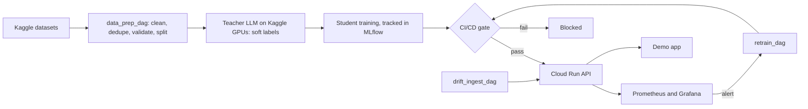

# Distillate: Distilled Real-Time Content Moderation

> **Content warning:** the datasets in this project contain slurs, threats, and hateful language. Examples in this repo and its dashboards are masked.

Distillate trains a small toxicity classifier that runs on CPU by distilling knowledge from a 4B-parameter open LLM. The student learns from human labels plus the teacher's per-label probabilities. Around the model is a full MLOps pipeline: versioned data, tracked experiments, a CI/CD evaluation gate, Cloud Run serving, monitoring with drift detection, and automated retraining.

**Course:** IE7374 Machine Learning Operations, Northeastern University (Prof. Ramin Mohammadi)

---

## How it works



| Component | Choice |
|---|---|
| Teacher (not final) | Leading option: Qwen3-4B-Instruct-2507, zero-shot, with a LoRA fine-tuned classifier as a fallback. Alternatives under evaluation: Kev-4B (open decision model that returns calibrated probabilities per question), Qwen3Guard-Gen-4B, Qwen3.5-4B, Gemma 4 E4B |
| Student (not final) | Leading option: DistilBERT. Also comparing MiniLM-L12 (smaller) and ModernBERT-base (larger); the served model is chosen from pilot results |
| Serving | FastAPI + ONNX Runtime (int8) on Cloud Run, CPU only |
| Pipelines | Airflow, DVC (GCS remote), MLflow |
| Monitoring | Prometheus, Grafana, Evidently, labeled canary set |
| Demo | Streamlit app: try-it page, moderation queue, status page |

## Data

| Dataset | Kaggle competition | Role | Rows |
|---|---|---|---|
| Wikipedia toxicity | [`jigsaw-toxic-comment-classification-challenge`](https://www.kaggle.com/c/jigsaw-toxic-comment-classification-challenge) | Training, validation, gate set | 159,571 train; 63,978 scored test |
| Civil Comments | [`jigsaw-unintended-bias-in-toxicity-classification`](https://www.kaggle.com/c/jigsaw-unintended-bias-in-toxicity-classification) | Shifted-domain test, drift stream, bias evaluation | 1,804,874 train; 97,320 per test file |

The TFDS copies of both datasets began returning HTTP 403, so the pipeline downloads the
original Kaggle competition files they were built from; ids and row counts are identical.
**Every teammate must accept both competitions' rules on Kaggle before downloading.** The
rules permit academic use and forbid redistributing the data, so raw text stays in private
storage and the repository holds only ids, scores, and metrics.

Raw text lives in a private GCS bucket and is pulled with DVC; Git holds only pointer files. Please cite Wulczyn, Thain, and Dixon (2017), "Ex Machina: Personal Attacks Seen at Scale", and Borkan et al. (2019), "Nuanced Metrics for Measuring Unintended Bias with Real Data for Text Classification".

## Repository layout

```text
Data-Pipeline/       Phase 1: dags/, scripts/, config/, data/, reports/, tests/
Model-Pipeline/      Phase 2: src/teacher, src/student, src/eval, kaggle/, artifacts/
Deployment/          Phase 3: serving/, monitoring/, frontend/, deploy/, dags/
docs/                Model card, data card, risk log, cost assumptions
.github/workflows/   CI/CD: tests, data checks, gate, build, deploy, rollback
.env.example         Project-wide template; each phase folder keeps its own copy
```

Each phase folder is self-contained and runs its own `docker compose`, which reads
`.env` only from its own folder. The authoritative file formats and interfaces are in
[Data-Pipeline/CONTRACTS.md](Data-Pipeline/CONTRACTS.md).

## Installation

**Prerequisites:** Docker Desktop with 8 GB of memory, Git, and a Kaggle account that has
accepted both competitions' rules. The `gcloud` CLI is needed only to push data to GCS.

Each phase folder runs its own `docker compose`, so **every command below is run from inside
that folder, not the repository root.** There is no compose file at the root; running
`docker compose up -d` there fails with *"no configuration file provided: not found"*.

Phase 1, the data pipeline:

```bash
git clone https://github.com/Nishaant-Soni/Distillate.git
cd Distillate/Data-Pipeline      # the compose file lives here
cp .env.example .env             # then add your Kaggle credentials
docker compose build             # 20-40 min the first time
docker compose up -d
```

Airflow is then at `localhost:8080`. Full setup, credentials and troubleshooting are in
[Data-Pipeline/README.md](Data-Pipeline/README.md); start there rather than here.

Phase 2 and Phase 3 each have their own folder and their own README, added as those
phases land.

## Usage

**1. Prepare data.** Trigger `data_prep_dag` from the Airflow UI, or from `Data-Pipeline/`:
```bash
docker compose exec airflow-scheduler airflow dags trigger data_prep_dag
```

**2. Generate teacher labels.** Open `kaggle/label_shards.ipynb` on Kaggle (T4 x2), add the GCS credential in Kaggle Secrets, and use "Save & Run All". The job writes shards to GCS and resumes where it left off if a session ends. `data_prep_dag` validates and merges the shards.

**3. Train a student.**
```bash
python -m src.student.distill --config params.yaml    # runs are logged to MLflow
```

**4. Run the evaluation gate locally.**
```bash
python -m src.eval.gate --model models/student.onnx   # exits non-zero if the gate fails
```

**5. Query the API.**
```bash
curl -X POST localhost:8000/predict \
  -H "Content-Type: application/json" \
  -d '{"text": "thanks for the helpful edit"}'
```
The response holds a score per label, the decision at the tuned thresholds, latency, and the model version.

**6. Start the demo app.**
```bash
streamlit run frontend/app.py
```

**7. Deploy.** Run `bash deploy/setup_gcp.sh` once per GCP project. After that, every merge to `main` runs CI, and a candidate that passes the gate is deployed to Cloud Run as a new revision.

## Operations

- **Monitoring:** Grafana shows latency, throughput, flagged rate per label, canary accuracy, delayed-label accuracy per drift batch, and drift scores.
- **Retraining:** an alert on accuracy or drift triggers `retrain_dag`. The new model reaches traffic only if it passes the same gate.
- **Rollback:** shift traffic back to the previous revision and point the MLflow `production` alias at the previous model version:
  ```bash
  gcloud run services update-traffic distillate-api --to-revisions=<previous-revision>=100 --region=<region>
  ```
- **Reproducibility:** data and splits are versioned with DVC; every teacher run records its prompt hash, model revision, and package versions; every training run is in MLflow.

## Privacy

The API does not log request text; monitoring stores only a text hash, its length, and the scores. Text typed into the demo app is discarded unless the visitor opts in.

## Team

Vaishnavi Hemal Jariwala, Nishaant Sitendra Soni, Ruchita Yogesh Patil, Praniti Sunil Kale, Shivam Singh, Sai Venkata Kashyap Akula

## License

Code: see `LICENSE`. Datasets keep their own licenses (above). Trained model weights are not published outside the course without instructor approval.
