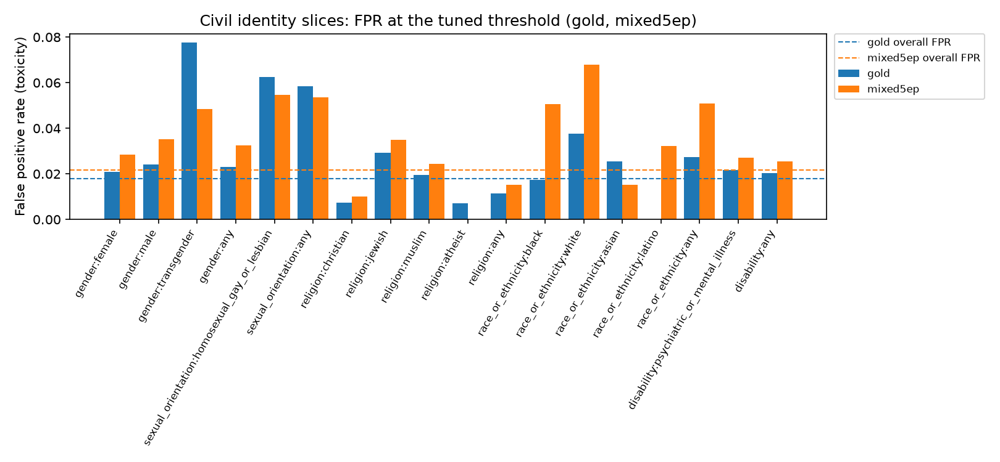

# Phase 2 bias report

> Generated tables, JSON and plots: [`phase2/bias_tables.md`](phase2/bias_tables.md),
> [`phase2/bias_phase2.json`](phase2/bias_phase2.json), [`phase2/plots/`](phase2/plots/).
> Produced by `python -m src.eval.bias` (`Model-Pipeline/src/eval/bias.py`) on the final
> prediction files in `phase2_results.zip`, with `--matched-fpr 0.05` and paired bootstraps
> (1,000 replicates) of each arm against the gold-only student.

## 1. Summary

- **Soft labels increase false positives on Black and White identity slices** compared with
  the gold-only student. Paired BPSN AUC, selected (mixed5ep) minus gold:
  race_or_ethnicity:white −0.053 [−0.065, −0.042], black −0.039 [−0.052, −0.026],
  any −0.041 [−0.051, −0.032]. Not every race slice moves the same way: asian improves
  (+0.028 [+0.012, +0.044]) and latino is borderline (−0.028 [−0.059, −0.001], n = 121).
- **Sexual orientation improves** with the selected model: sexual_orientation:any +0.026
  [+0.007, +0.042]. **Religion and disability are unchanged.**
- **Every soft-label arm shows the race drop, including the TF-IDF arm**, so it isn't
  specific to the LLM. It is smallest for the selected model (gold mixed with stack soft
  labels) and largest with calibrated-Qwen labels (race_or_ethnicity:any −0.111).
- So distillation's effect on bias is **mixed and slice-dependent**: amplified for Black and
  White identity mentions, reduced for sexual orientation.
- The selected model **passes** the 5-point flag at its tuned threshold (worst slice
  race_or_ethnicity:white, +4.6 points, 3.1× overall FPR) and the gate's bias check.
- **No mitigation variant was trained in Phase 2** (section 6). Race-slice FPR is tracked in
  Phase 3 monitoring, and a proper mitigation experiment is planned there (section 7).

## 2. What was evaluated

**Arms** (all DistilBERT; each at its own thresholds tuned on Wikipedia validation):

| Arm | Folder | Training targets | Toxicity threshold |
|---|---|---|---|
| gold | `distilbert-gold` | gold labels only (alpha = 1) | 0.62 |
| stack | `distilbert-stack` | stack-teacher soft labels only (alpha = 0) | 0.47 |
| tfidf | `distilbert-tfidf` | gold + TF-IDF out-of-fold soft labels (attribution arm) | 0.30 |
| calqwen | `distilbert-calqwen` | gold + calibrated-Qwen soft labels (attribution arm) | 0.39 |
| selected | `distilbert-mixed-5ep` | gold + stack soft labels, tuned alpha and T, 5 epochs | 0.35 |

**Selection status:** `selection.md` reports that no arm passes the selection rule, because
every arm misses the CPU latency budget (p95 about 145 ms against 50 ms; p50 about 30 ms).
This report treats `distilbert-mixed-5ep` as the selected candidate, pending the team's
final selection.

**Data:** the Civil Comments bias set (identity-annotated test rows, 21,577 rows; toxic rate
11.1%). Slices are each identity attribute at >= 0.5 and each group (gender, sexual
orientation, religion, race or ethnicity, disability); 18 slices have at least 100 rows and
are judged. The bias set is used for evaluation only, never for choosing models, thresholds
or weights. The Wikipedia lexicon slices were not computed: the gold validation file in
`phase2_results.zip` lacks `has_identity_term`, `char_len` and `has_obfuscation` (the run
prints a warning).

**Metrics per slice:** subgroup AUC, BPSN AUC and BNSP AUC (Borkan et al., 2019), plus FPR,
FNR and F1 at the arm's tuned threshold (Fairlearn MetricFrame). A judged slice is flagged
when its FPR is 5 or more points above overall.

**Why BPSN and matched FPR lead.** The thresholds tuned on Wikipedia give a low overall Civil
FPR (1.1% to 2.2% across arms). At that rate a 5-point gap allows a slice several times the
overall rate: the selected arm's race_or_ethnicity:white FPR is 3.1× overall, yet only +4.6
points. The analysis therefore also reports:

- the **FPR ratio** (slice / overall);
- **BPSN AUC**, which doesn't depend on any threshold, as the main comparison between arms;
- a **matched-FPR comparison**: each arm at the threshold that gives 5% overall Civil FPR
  (for comparing arms only, not a deployment threshold);
- **paired bootstrap intervals** for BPSN differences against the gold-only student,
  resampling the same rows for both arms.

## 3. Results

### 3.1 Per-arm overview (Civil bias set, toxicity, tuned thresholds)

| Arm | AUC | F1 | Overall FPR | Worst judged slice | FPR gap (pts) | FPR ratio |
|---|---|---|---|---|---|---|
| gold | 0.874 | 0.475 | 1.8% | gender:transgender | +6.0 ⚑ | 4.3× |
| stack | 0.887 | 0.411 | 1.1% | race_or_ethnicity:white | +2.6 | 3.4× |
| tfidf | 0.868 | 0.462 | 2.2% | sexual_orientation:any | +8.0 ⚑ | 4.6× |
| calqwen | 0.877 | 0.424 | 2.0% | race_or_ethnicity:white | +5.9 ⚑ | 3.9× |
| selected | 0.887 | 0.484 | 2.2% | race_or_ethnicity:white | +4.6 | 3.1× |

⚑ = flagged by the 5-point rule. The gold-only student is flagged on transgender (n = 129);
the selected model is not flagged at its tuned threshold.

### 3.2 Race and ethnicity

Paired BPSN AUC, arm minus gold (95% interval):

| Slice (n) | selected | stack | tfidf | calqwen |
|---|---|---|---|---|
| black (761) | −0.039 [−0.052, −0.026] | −0.055 [−0.069, −0.040] | −0.059 [−0.073, −0.046] | −0.080 [−0.097, −0.063] |
| white (1,178) | −0.053 [−0.065, −0.042] | −0.068 [−0.081, −0.056] | −0.054 [−0.066, −0.042] | −0.137 [−0.153, −0.121] |
| asian (217) | +0.028 [+0.012, +0.044] | +0.028 [+0.010, +0.046] | +0.017 [+0.000, +0.035] | −0.027 [−0.054, −0.002] |
| latino (121) | −0.028 [−0.059, −0.001] | −0.040 [−0.073, −0.009] | −0.027 [−0.056, −0.001] | −0.096 [−0.135, −0.060] |
| any (1,911) | −0.041 [−0.051, −0.032] | −0.054 [−0.065, −0.044] | −0.048 [−0.057, −0.038] | −0.111 [−0.124, −0.098] |

At a matched 5% overall FPR, the gold-only student flags no race slice, while every
soft-label arm flags black, white and any (2.1× to 3.8× the overall rate); calibrated-Qwen
also flags latino. The selected model's ratios there are 2.3× (black), 2.8× (white) and
2.3× (any).

### 3.3 Sexual orientation

| Slice (n) | selected | stack | tfidf | calqwen |
|---|---|---|---|---|
| homosexual_gay_or_lesbian (538) | +0.030 [+0.010, +0.046] | +0.022 [+0.001, +0.040] | −0.027 [−0.047, −0.010] | +0.062 [+0.039, +0.083] |
| any (570) | +0.026 [+0.007, +0.042] | +0.018 [−0.003, +0.034] | −0.031 [−0.050, −0.013] | +0.057 [+0.035, +0.078] |

The gain comes from the Qwen side of the teacher: calibrated-Qwen labels improve these slices
most, while TF-IDF labels make them worse. At matched 5% FPR, sexual-orientation slices are
flagged for every arm except calibrated-Qwen, gold included (3.2×), so this is a
long-standing gap that the selected model narrows (2.8×) rather than a new one.

### 3.4 Religion, gender and disability

- **Religion:** no change for the selected, stack or TF-IDF arms (religion:any intervals
  include 0); atheist improves for selected and stack (n = 149). Calibrated-Qwen labels make
  religion worse (religion:any −0.036; muslim −0.056; jewish −0.038).
- **Gender:** small decreases for the selected model (about −0.009 to −0.010, intervals just
  excluding 0) and larger ones for TF-IDF (about −0.024) and calibrated-Qwen (about −0.037).
  With 18 judged slices, small isolated differences can be chance; the selected model's
  gender differences are treated as negligible. Transgender (n = 129) improves for the
  selected model (+0.028, interval includes 0) and is no longer flagged.
- **Disability:** unchanged except a small decrease with TF-IDF labels (about −0.022).

### 3.5 Selected student by identity group

`distilbert-mixed-5ep`, Civil bias set, toxicity at its tuned threshold (0.35). The 18 judged
slices (n >= 100); smaller slices are in [`phase2/bias_tables.md`](phase2/bias_tables.md).

| Slice | n | Toxic rate | Subgroup AUC | BPSN AUC | BNSP AUC | FPR | FPR ratio | FPR gap (pts) | FNR | F1 |
|---|---|---|---|---|---|---|---|---|---|---|
| **overall** | 21,577 | 0.111 | 0.887 | | | 0.022 | 1.0× | | 0.625 | 0.484 |
| gender:female | 2,602 | 0.135 | 0.874 | 0.851 | 0.908 | 0.028 | 1.3× | +0.7 | 0.660 | 0.447 |
| gender:male | 2,112 | 0.152 | 0.864 | 0.838 | 0.910 | 0.035 | 1.6× | +1.3 | 0.600 | 0.501 |
| gender:transgender | 129 | 0.202 | 0.786 | 0.822 | 0.862 | 0.049 | 2.2× | +2.7 | 0.692 | 0.410 |
| gender:any | 3,960 | 0.145 | 0.868 | 0.841 | 0.912 | 0.032 | 1.5× | +1.1 | 0.632 | 0.472 |
| sexual_orientation:homosexual_gay_or_lesbian | 538 | 0.286 | 0.800 | 0.766 | 0.907 | 0.055 | 2.5× | +3.3 | 0.604 | 0.517 |
| sexual_orientation:any | 570 | 0.281 | 0.805 | 0.769 | 0.908 | 0.054 | 2.5× | +3.2 | 0.613 | 0.508 |
| religion:christian | 2,109 | 0.100 | 0.869 | 0.914 | 0.838 | 0.010 | 0.5× | −1.2 | 0.700 | 0.432 |
| religion:jewish | 411 | 0.165 | 0.843 | 0.848 | 0.885 | 0.035 | 1.6× | +1.3 | 0.735 | 0.367 |
| religion:muslim | 1,054 | 0.221 | 0.787 | 0.865 | 0.836 | 0.024 | 1.1× | +0.3 | 0.764 | 0.357 |
| religion:atheist | 149 | 0.067 | 0.904 | 0.913 | 0.868 | 0.000 | 0.0× | −2.2 | 0.800 | 0.333 |
| religion:any | 3,316 | 0.134 | 0.852 | 0.902 | 0.846 | 0.015 | 0.7× | −0.6 | 0.727 | 0.397 |
| race_or_ethnicity:black | 761 | 0.323 | 0.774 | 0.808 | 0.873 | 0.050 | 2.3× | +2.9 | 0.740 | 0.381 |
| race_or_ethnicity:white | 1,178 | 0.300 | 0.772 | 0.773 | 0.897 | 0.068 | 3.1× | +4.6 | 0.669 | 0.445 |
| race_or_ethnicity:asian | 217 | 0.097 | 0.902 | 0.894 | 0.892 | 0.015 | 0.7× | −0.6 | 0.667 | 0.452 |
| race_or_ethnicity:latino | 121 | 0.231 | 0.847 | 0.874 | 0.865 | 0.032 | 1.5× | +1.1 | 0.786 | 0.324 |
| race_or_ethnicity:any | 1,911 | 0.272 | 0.795 | 0.807 | 0.892 | 0.051 | 2.4× | +2.9 | 0.692 | 0.427 |
| disability:psychiatric_or_mental_illness | 238 | 0.227 | 0.865 | 0.832 | 0.909 | 0.027 | 1.3× | +0.5 | 0.630 | 0.506 |
| disability:any | 252 | 0.218 | 0.865 | 0.839 | 0.906 | 0.025 | 1.2× | +0.4 | 0.636 | 0.500 |

**Gate verdict:** no judged slice is 5 or more points above overall FPR, so the selected
model passes the 5-point flag; the worst slice is race_or_ethnicity:white at +4.6 points
(3.1× overall). It also passes the gate's bias check (block above 10 points; there is no
production model yet, so the rise check doesn't apply).

### 3.6 Plots

Per-slice FPR at each model's tuned threshold, with each model's overall FPR as a dashed line.

## 4. Does distillation pass on or amplify bias?

**Mixed and slice-dependent.** Relative to the gold-only student:

- **Amplified for Black and White identity mentions.** Every soft-label arm raises false
  positives there, including the TF-IDF arm, so the effect isn't specific to the LLM. Both
  sources of soft labels contribute: TF-IDF labels (−0.048 on race:any) and, more strongly,
  calibrated-Qwen labels (−0.111). The selected model, which mixes gold with the stack's
  soft labels, shows the smallest drop (−0.041).
- **Reduced for sexual orientation**, driven by the Qwen side.
- **Unchanged for religion and disability** in the selected model.

The teacher itself isn't scored on the bias set (its labels cover the training rows and the
gate subset), so its bias can only be inferred through the student arms.

## 5. Likely mechanism

The sensitivity analysis (model card §7.2, SHAP token attributions) shows identity words
driving identity_attack false alarms: comments that mention a race tend to be scored as
attacks. That is consistent with the race-slice BPSN drop here.

## 6. Mitigation decision: no variant in Phase 2

The plan's mitigation is to retrain the selected recipe with Phase 1's `sample_weight` when a
slice is flagged. The team agreed (Nov 13) not to train a variant in Phase 2:

1. **The Phase 1 weights can't produce a variant.** Phase 1's selection rule chose factor 1,
   so every `sample_weight` is 1.0 and a "weighted" model would be identical.
2. **A retrain now would change every reported number** the day before submission.
3. **Choosing a new up-weighting factor would mean tuning on `bias_eval`**, the evaluation
   set, which would make its results optimistic.

The selected model passes the 5-point flag at its tuned threshold (worst +4.6) and the gate's
bias check, so release isn't blocked; the race finding is documented here and in the model
card.

**Per-group thresholds are rejected:** the service never knows a commenter's identity, so it
applies one threshold per label to everyone.

## 7. Phase 3 follow-up

- **Monitoring:** track race-slice FPR (black, white, any) in the Phase 3 dashboards, with an
  alert threshold.
- **Mitigation experiment:** reweighting or counterfactual augmentation of non-toxic
  identity-term comments, with the factor or setting chosen on a held-out slice, not on
  `bias_eval`.
- **Wikipedia lexicon slices:** rerun with `load_data`'s validation table, which has the
  derived columns.

## 8. Limits

- **Multiple comparisons:** 18 judged slices per comparison. The race finding rests on large
  slices (761 to 1,911 rows) with intervals well clear of 0 in every soft-label arm; small
  isolated differences (gender in the selected model, small slices such as latino and
  atheist) are reported but not treated as findings.
- **Low operating FPR:** at 1% to 2% overall FPR, point gaps understate relative disparities;
  read ratios and BPSN alongside them.
- **Approximate identity annotation:** Civil identity attributes are rater fractions; a slice
  is any row at >= 0.5.
- **Rater bias:** gold labels come from crowd raters, whose biases are in the labels.
- **Missing groups:** no age or location fields.
- **Teacher not scored directly** on the bias set (section 4).
- **Selection pending** (section 2).
